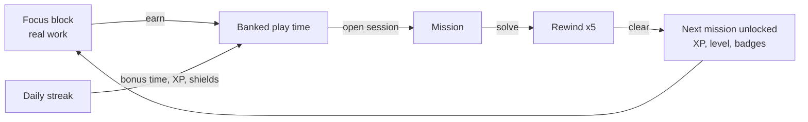
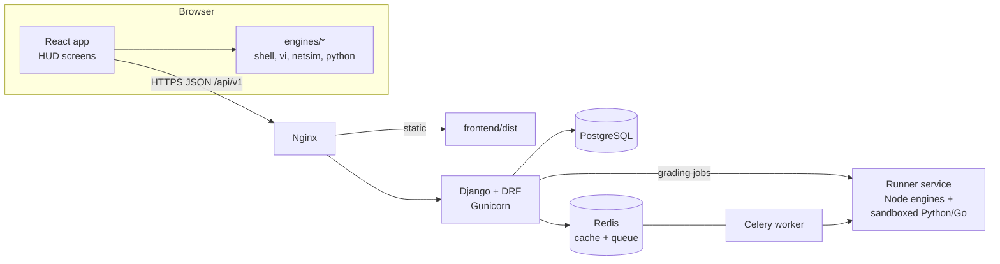
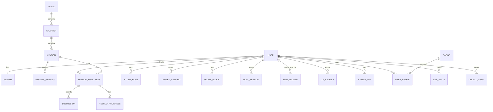

# Uptime Arcade: Design and Architecture

**Version:** 1.1 (2026-11-07)
**Owner:** raven
**Stack:** Django REST Framework + React (Vite), built on the *DRF React Foundation* template
**Status:** approved for build

---

## Contents

1. [How to use this document](#1-how-to-use-this-document)
2. [Vision and aim](#2-vision-and-aim)
3. [The core loop](#3-the-core-loop)
4. [Look and feel](#4-look-and-feel)
5. [Screens and routes](#5-screens-and-routes)
6. [Game systems](#6-game-systems)
7. [Learning design](#7-learning-design)
8. [Mission catalogue (213 core missions)](#8-mission-catalogue-213-core-missions)
9. [NetLab: the network simulator](#9-netlab-the-network-simulator)
10. [Simulation engines](#10-simulation-engines)
11. [System architecture](#11-system-architecture)
12. [Repository layout](#12-repository-layout)
13. [Content pipeline](#13-content-pipeline)
14. [Grading and trust](#14-grading-and-trust)
15. [Data model](#15-data-model)
16. [API](#16-api)
17. [Non-functional requirements](#17-non-functional-requirements)
18. [Testing strategy](#18-testing-strategy)
19. [Delivery plan (milestones)](#19-delivery-plan-milestones)
20. [Building it with Claude Code in VS Code](#20-building-it-with-claude-code-in-vs-code)
21. [Open questions](#21-open-questions)

---

## 1. How to use this document

- **What it is:** the single source of truth for what Uptime Arcade is and how it's built. Save it in the repository as `docs/DESIGN.md`.
- **Writing code:** each milestone in [section 19](#19-delivery-plan-milestones) is one unit of work with acceptance criteria. Build them in order.
- **Changing decisions:** edit this file in the same pull request, and record the reason as an ADR in `docs/adr/`.
- **Words used here:**

| Term | Meaning |
|---|---|
| Track | One skill path: Shell, vi, Python, Go, Networking, NetLab |
| Chapter | A group of missions inside a track that teach one idea |
| Mission | One lesson plus one task with a check |
| Rewind | Five review tasks that must be cleared to unlock the next mission |
| Operation | A multi-skill mission that combines several tracks |
| Focus block | A real-world work timer that earns play time |
| Session | Spending banked play time, the only time missions can be played |
| Cleared | Mission solved *and* its rewind finished |

---

## 2. Vision and aim

**Uptime Arcade turns real focus into play time, and spends that play time teaching real technical skills.**

The aim never changes, whatever features are added:

1. **Focus comes first.** You can only play with time earned by finishing real focus blocks. There's no free or unlimited play.
2. **Every minute of play teaches a usable skill.** Missions use real commands, real syntax and real networking behaviour, so the skills carry over to a job.
3. **Learning is step by step.** Each track starts at zero and builds one idea at a time. Nothing is used before it's taught.
4. **Practice is reinforced.** Rewind tasks make you recall what you just learned before you move on.
5. **It's honest and private.** It's a single-player game for self-improvement. Cheating only cheats yourself, but the server still guards the economy so the game stays meaningful.

**Who it's for:**
- The owner first: a security and ICT professional building shell, vi, Python, Go and networking depth.
- Later, students, junior sysadmins and network learners who want guided practice.

**The setting:** the player joins **Whiteraven**, a fictional cloud and network company, as a *Noob* and rises to *Archmage*. The story comes from departments (Support, SRE, Platform, Network, Security, Finance) that send tickets and incidents.

---

## 3. The core loop



1. Set a goal and start a focus block (15, 25 or 45 minutes) with your phone out of reach.
2. When the timer ends, confirm whether you finished the goal, and the server credits play time.
3. Open a session. Its clock runs on server time until the play time is used or you close it.
4. Read the lesson, then solve the mission in its tool (terminal, vi, Python, Go reader or NetLab).
5. Pass five rewind tasks to clear the mission and unlock the next one.
6. Earn XP, level up, and keep a daily streak for bonus rewards.

---

## 4. Look and feel

### 4.1 Direction

The look is a **holographic operator HUD inside a data centre**. Glowing cyan lines, gold frames and highlights for things that matter, and an animated reactor core at the centre of the home screen. It's drawn directly into an aisle of server racks and hologram panels showing real network maps, code and terminal output, with a network map on the far wall and a polished floor that reflects it all. The scene runs to every edge of the window ([ADR 0003](adr/0003-scene-as-the-surface.md), [ADR 0008](adr/0008-data-centre-and-terminal.md)). A hooded operator stands in the aisle and projects the core above them.

Display titles are metallic with a slight chromatic split, buttons and tiles have cut corners, and the login and register cards are violet glass. The scene is painted in code from a seeded generator, so no image files ship. It's an original design for Whiteraven, so it uses no logos, characters or marks from any film, game or brand.

The look is calm when idle and lights up on achievement. Animation is used for moments that matter, such as level-ups, unlocks and the timer, never as constant noise.

### 4.2 Design tokens

These are carried over from the current game and defined once in `frontend/src/styles/tokens.css`:

| Token | Value | Use |
|---|---|---|
| `--void` | `#05040c` | Page background |
| `--veil`, `--rail`, `--tile`, `--pane` | near-black violets | Reading screens, Deck rows, solid tiles and the workspace |
| `--glass-strong` | `rgba(8,6,22,.88)` | Inputs, code, overlays |
| `--line`, `--line-soft` | translucent blue and lilac | Input borders, hairlines between sections |
| `--line-gold` | `rgba(255,200,96,.55)` | Frames on tiles, plaques and the Deck |
| `--holo`, `--holo-soft` | `#4fd8ff`, `#b3edff` | Primary accent, active nav, secondary text |
| `--violet`, `--magenta` | `#a66bff`, `#ff4fd8` | The hologram's second colours |
| `--metal` | vertical gradient, white to periwinkle | Metallic display titles |
| `--text`, `--dim` | `#e8f1ff`, `#a0a9cc` | Body text, secondary text |
| `--amber` | `#ffc24d` | Gold: timer, objectives, rewards, frames |
| `--ok`, `--danger` | `#5ef0b0`, `#ff3d5a` | Success and cleared, errors and alerts |
| `--cta`, `--on-accent` | `#f4f7ff`, `#070512` | The white button on login and register, text on accent buttons |
| `--term-*` | soft off-whites on `#0b0b1e` | The terminal's own palette, tested at 7:1 or better |
| `--scene-*`, `--coat-*` | dark violets | The room and the operator |
| `--ember-*`, `--jade-*`, `--holo-*`, `--violet-*`, `--gold-*`, `--rank-*`, `--blood-*` | two stops each | The metal of each badge family |
| `--diff-*` | green, cyan, gold, orange, red | Difficulty levels |
| `--heat-*`, `--chart-*` | a green ramp, plus green and gold marks | The focus map and charts. Each measure keeps its colour, and they're checked with a palette validator |

| Role | Font | Fallback |
|---|---|---|
| Display and UI | **Oxanium** 400, 600, 800 | Segoe UI, system-ui |
| Code, terminal, consoles | **IBM Plex Mono** 400, 500, 700 | ui-monospace, Consolas |

Fonts are self-hosted from `frontend/public/fonts/`, so the game works offline.

### 4.3 Components (the HUD kit)

| Component | Description |
|---|---|
| `SceneBackdrop` | The painted data centre, filling the window. |
| `OperatorFigure` | The player's silhouette on the Deck and login, with a projector beam and a floor plate. |
| `HudPanel` | A section with no box of its own, separated from its neighbours by a hairline. Optional title label in spaced uppercase. |
| `CoreRing` | The reactor: an SVG with a rotating dashed outer ring, a counter-rotating inner ring, a pulsing glow, and an amber arc showing progress to the next level. Shows the level number and title in the centre. |
| `TimerRing` | Big amber countdown with a circular progress arc, used on Focus. |
| `MissionNode` | A diamond on a track path. Locked is dim, open is a glowing cyan outline, rewind is amber, cleared is green. |
| `Meter` | Thin glowing bar with a label and value. |
| `Toast` | Bottom-centre amber notice that disappears after about 3.5 seconds. |
| `Overlay` | Full-screen dimmed layer for debriefs, level-ups and the finale. |
| `Terminal` | Monospace console. Each command is its own block with a result. Shows a grey suggestion and a help line while typing, and history and Tab completion. Text rules are in [ADR 0008](adr/0008-data-centre-and-terminal.md) and enforced by a test. |
| `ViEditor` | Full-pane modal editor with cursor, status bar and key counter. |
| `CodeEditor` | Python editor with a Run tests button and an output pane. |
| `TopologyCanvas` | NetLab map with devices, cables, link lights and packet animation. |
| `DeviceConsole` | A NetLab device CLI in a terminal, opened by clicking a device. |
| `BadgeEmblem` | A hexagonal medal drawn in code with its own glyph for every badge, sharp at any size for the Rewards wall, toasts and share cards. Locked medals keep their shape in grey. |
| `Avatar` | A player's uploaded picture, or one of sixteen operators drawn in code. |
| `Badge`, `LadderRow` | Rewards screen pieces. |

### 4.4 Motion and sound

- **Idle:** the core rings rotate slowly (30 to 46 seconds per turn), the glow pulses every 3.2 seconds, and the room's lights breathe over 6 seconds. Nothing moves behind terminal text.
- **Unlock:** the next node flashes from cyan to white to cyan, and a short rising chime plays.
- **Level-up:** a full-screen overlay scales up the new title with a bright glow, and a three-note chord plays.
- **Timer end:** a two-tone chime.
- **NetLab:** packets travel along cables as small glowing dots, green when delivered and red when dropped, with a reason shown.
- **Sound:** generated in the browser with Web Audio, so no files are needed. It's off until the first click, and a mute toggle is on System.
- **Reduced motion:** with `prefers-reduced-motion`, rotation, pulsing, lava breathing and packet animation stop, and state changes are instant.

### 4.5 Layout rules

- **Desktop:** the HUD fills the window with no page scroll, and only sections scroll. Reading screens sink the scene under one veil, and the Deck shows it at full strength.
- **Under 1040px:** columns stack and the page scrolls over a fixed scene.
- **Under 400px:** everything still works, though NetLab shows a "best on a larger screen" note and allows pinch zoom.
- **Readability:** body text is at least 14px, and contrast is at least 4.5:1. Terminal text reaches 7:1, and has no glow, blur, animation or scanlines over it.

---

## 5. Screens and routes

Each screen is its own route, and the top bar shows the logo, navigation, level, XP, streak and the play-time or session clock.

| Route | Screen | Purpose |
|---|---|---|
| `/` | **Deck** | The core ring with your level and clock, tiles for streak and focus, skill paths with their medals, and a strip with the next mission, level progress and badges. It always fits the window with nothing to scroll, from a small phone to a large monitor, folding details away as room runs out |
| `/focus` | **Focus** | Set your study plan first. Then set a goal and length, see what the block will earn, check off "phone out of reach", watch the timer ring, answer its one check-in, log drifts, and claim with a line on what you did. Weekly and monthly goals sit beside it |
| `/missions` | **Missions** | A card per category with progress, difficulty mix and its chapters cycling. Opening one reveals chapter dropdowns. Tracks on the way show what opens them |
| `/missions/:slug` | **Briefing** | Lesson and example, mission brief, sender, worth and par, plus the Launch button |
| `/missions/:slug/play` | **Play** | Mission panel on the left, workspace on the right (terminal, vi, Python, Go reader or NetLab) |
| `/missions/:slug/rewind` | **Rewind** | Five tasks with progress pips and feedback |
| `/ops` | Redirect | Operations is a category on the Missions screen, and each locked one says what opens it |
| `/oncall` | **On-call** | Endless incident shifts, unlocked after all track missions are cleared. Arrives in M11 ([ADR 0007](adr/0007-the-game-runs-on-the-server.md)) |
| `/rewards` | **Rewards** | Streak ladder, level ladder and badge grid |
| `/sandbox` | **Sandbox** | Your own network with no goals: add, drag, cable and configure devices, test every ping, and break something to practise. It opens after LAB-05 and is free |
| `/profile` | **Profile** | Your picture (sixteen operators, or upload your own), stats, a year's focus map, goals, focus minutes a day, XP a week, and recent blocks. Your username and picture stay at the top right of every screen |
| `/system` | **System** | Account, time zone, sound, close session, logout, delete account |
| `/login`, `/register` | Auth | Styled in the HUD, and they fit the window too. They only scroll if a phone's keyboard takes the room. Log in with a username, which shows available or taken as you type. Email stays private |

**Locks:**
- Play and Rewind need an active session. Without one, they show a panel with "Open session (MM:SS)" or "Go to Focus".
- When a focus block finishes, every screen sends you to Focus to claim it.

---

## 6. Game systems

All numbers live in one config file, `backend/apps/game/rules.py`, so balancing never needs a migration.

### 6.1 Focus economy

| Block | Play time | Goal bonus | XP |
|---|---|---|---|
| 15 min | 5:00 | +2:00 | 15 (+10 for the goal) |
| 25 min | 8:00 | +2:00 | 25 (+10 for the goal) |
| 45 min | 15:00 | +2:00 | 45 (+10 for the goal) |

- **Bank caps:** focus blocks can bank up to 30:00, and streak rewards can raise the bank to 60:00.
- **Starting bank:** 5:00, so a new player can try a mission right away.
- **Ending early:** earns nothing.
- **Drifts:** logging one is free. A block with zero drifts counts as a clean block.
- **Server time:** the server records `started_at` and `ends_at`, and a claim before `ends_at` on the server clock is rejected.

**What makes a block earn ([ADR 0010](adr/0010-study-plans.md)).** Nothing can prove someone studied, so the aim is to make idling pointless.

- **Study plan:** before their first block, a player sets their days, blocks a day, block length and up to three study times, in their own time zone. Blocks a day times length is their daily amount.
- **Limits on a plan:** study times need at least 30 minutes each, must add up to the daily amount, and can't pass the larger of 4 hours or three times the daily amount, because a plan covering all day isn't a plan.
- **Changing it:** the first plan starts today and can be corrected until a block has started. After that it can change once every 7 days, and a change starts tomorrow, so a plan can't be moved to wherever you are now. Moving your time zone also takes effect tomorrow and doesn't use up the weekly change.
- **Each block is one of three kinds, decided when it starts:**
  - **Plan:** a study day, inside a study time (only the start has to be), fitting what's left of the daily amount. Pays in full.
  - **Make-up:** outside that, covering planned minutes not yet earned this week. Pays in full. Two a week. Unused minutes don't carry into the next week.
  - **Extra:** everything else. Goes on the map and counts towards totals and focus badges, but pays no play time or XP and doesn't touch the streak.
- **The ceiling:** minutes paid in a week can never pass the minutes planned up to that day, whatever mix of blocks someone tries.
- **Check-in:** each block asks once if you're still there, at a random moment from a quarter of the way through, with 3:00 to answer. The moment stays on the server until it's due. Missing it voids the block: no pay, not on the map, and the day's amount is free again.
- **Claiming:** needs a line of 5 to 140 characters on what you actually did, within 15:00 of the block ending. After that the block earns nothing.

**Goals** are worked out from the plan, and count minutes that earned:

| Goal | Target | Reward | Cap |
|---|---|---|---|
| Week (Monday to Sunday) | 80% of planned minutes | 6 s of play and 1 XP per target minute | 20:00 of play |
| Month | 75% of planned minutes | 3 s of play and 1 XP per target minute | 45:00 of play |

Targets round up to the next 5 minutes and count only days from when the plan started. Each pays once, and rewards can raise the bank to the same 60:00 as streak rewards.

### 6.2 Sessions

- **Opening:** moves the whole bank into a session with `expires_at = now + bank`.
- **Closing:** returns the unused seconds to the bank. A Stop button sits beside the timer on every screen.
- **Finishing:** clearing a mission closes the session by itself and sends the rest back to the bank. Solving it doesn't, because its questions still need the session ([ADR 0014](adr/0014-confirmed-email-and-a-clock-that-stops.md)).
- **Enforcement:** submissions for missions and rewinds are rejected with `409 no_active_session` when no session is active. Replays of cleared missions are the exception: they need no session, and they're refused while a focus block runs.

### 6.3 XP and scoring

| Event | XP |
|---|---|
| Mission cleared (solved and rewind finished) | By difficulty: Easy 100, Medium 130, Hard 160, Expert 200. In Beyond: 200, 300, 400, 500, Brainfuck 750. Operations 250 |
| Par bonus | +20: commands at or under par (shell and terminal goals), keys at or under par (vi), or first try (other check types) |
| Hint | −15 each, with a mission never worth less than 10 |
| On-call incident | 60, plus 100 per finished shift of five |
| Focus block | The block's minutes, plus 10 if the goal was finished (section 6.1) |
| Streak multiplier | +5% per streak day, up to +50% at 10 days, applied to all XP above |

Solving a mission and answering rewind questions pay nothing on their own. The mission's whole value is paid once, when its rewind is finished ([ADR 0006](adr/0006-xp-difficulty-and-beyond.md)).

### 6.4 Levels

Levels count **cleared** missions, so the ladder rewards finishing the rewind as well as solving. There are 200 launch missions.

| # | Title | Cleared |
|---|---|---|
| 1 | Noob | 0 |
| 2 | Initiate | 10 |
| 3 | Apprentice | 25 |
| 4 | Operator | 45 |
| 5 | Adept | 70 |
| 6 | Specialist | 95 |
| 7 | Technomancer | 125 |
| 8 | Sorcerer | 155 |
| 9 | Sage | 185 |
| 10 | Archmage | 213 |

The `peak` value remembers the highest count reached, so a new season never lowers your title.

Until NetLab and Operations arrive, the game uses this ladder scaled to its 150 missions: 0, 8, 19, 34, 52, 71, 90, 109, 128, 150.

### 6.5 Rewind

After a mission is solved, the player answers five questions about it, easiest first:

| # | Level | Type | Example |
|---|---|---|---|
| 1 | Easy | The main idea | Which sentence best describes what this mission taught? |
| 2 | Easy | Spot the solution | Which command solved it? |
| 3 | Medium | Put it in order, or why it matters | Tap the parts of this pipeline from first to last |
| 4 | Medium | Fill the gap | `sort -k6 ____ api.log`, answer `-n` |
| 5 | Hard | From memory | What was the answer to this mission? |

- **The next question** comes as soon as you answer, with how the last one went above it. There's nothing to click.
- **Wrong answers** don't show the right one. The question moves to the end of the queue, and costs nothing.
- **Hints** appear once every question still left has been failed at least once.
- **The answer** shows after three misses on one question, so nobody gets stuck.
- Progress is saved, so you can leave and come back.
- Questions are written in each mission's YAML and can be edited there. The server sends a question without its answer.

### 6.6 Unlock rules

- **Tracks:** a mission opens when the previous mission in its track is cleared. The first mission of each track is open from the start.
- **Operations:** each one lists prerequisite missions and opens when all of them are cleared.
- **On-call:** opens when every track mission is cleared.
- **NetLab:** a lab opens when the previous lab is cleared and the Networking mission named in its `requires` is cleared, because each lab assumes what that mission teaches ([ADR 0011](adr/0011-netlab.md)). The track opens with the first lab's gate.
- **Seeing it happen:** whichever comes last opens the lab, and that's when its `unlocked` event is sent. The event carries a preview of the lab's devices and cables, with no config, and the lab draws itself on screen. The NetLab card shows every lab on one long cable that lights up as labs clear ([ADR 0013](adr/0013-wires-by-hand.md)). If a lab is cleared and the next is still waiting, a `lab_waiting` event names the mission it needs.

### 6.7 Daily streaks

The streak grows by 1 on each calendar day (in the player's time zone) with at least one claimed block that earned. Days off in your plan don't break it.

| Milestone | Play time | XP | Shield |
|---|---|---|---|
| 3 days | +5 min | +50 | |
| 7 days | +10 min | +150 | +1 |
| 14 days | +15 min | +300 | |
| 21 days | +15 min | +500 | +1 |
| 30 days | +20 min | +1000 | |
| 60 days | +30 min | +2000 | +1 |
| 100 days | +30 min | +5000 | +1 |

- **Rewards:** each milestone pays once per account.
- **Shields:** a shield covers one missed study day and is used automatically. If more study days were missed than shields held, the streak resets to 1 and the shields are kept.

### 6.8 Badges (launch set)

| Badge | Condition |
|---|---|
| First Block | Finish one focus block |
| Clean Ten | 10 blocks with no drifts |
| Ten Hours, Hundred Hours | 600 and 6000 focus minutes |
| Full Week, Iron Month, Centurion | 7, 30 and 100-day streaks |
| First Clear | Clear one mission |
| Initiate to Sage | Reach levels 2 to 9, one badge each |
| Shell, vi, Python, Go, Networking and NetLab Master | Clear the whole track (NetLab arrives with M6) |
| Operator of Operations | Clear all Operations (arrives with M7) |
| Par Hunter | 50 missions at or under par |
| No Hints Needed | Clear a whole chapter without hints |
| Night Shift | Finish 25 on-call incidents |
| Archmage | Clear all 213 core missions |
| Easy, Medium, Hard, Expert and Brainfuck Conquered | Clear that tier of Beyond |

Every badge has its own medal (`BadgeEmblem`), designed to look good on its own when shared.

### 6.9 Seasons and on-call

- **Seasons are content we publish.** A new season adds new missions. Players can't start or reset one, and nothing they've done is ever taken away ([ADR 0009](adr/0009-seasons-gates-and-profiles.md)).
- **Replaying:** every cleared mission stays open to play again. It costs no play time, pays no XP and changes nothing. A running session is paused so its clock can't spend anything, and replays wait for a focus block to end ([ADR 0012](adr/0012-free-replays-and-a-complete-netlab.md)).
- **On-call:** shifts have five generated incidents (subnet maths, log queries, Go and Python tracing, NetLab micro-faults). Generation uses a server-side seed, so answers are never sent to the browser. Arrives in M11.

### 6.10 New content after launch

Content packs (section 13) add missions to existing tracks or new tracks. Archmage stays tied to the 200 launch missions. New packs add new badges and a "Mastery" rank shown as stars beside the title, one star for every 25 extra missions cleared.

---

## 7. Learning design

**Principles:**
1. **One new idea per mission.** The lesson teaches it with a tiny example on different data, and the mission makes you use it.
2. **Never use something before it's taught.** Every command, flag and keyword in a solution must appear in the same or an earlier lesson in that track, and CI checks this (section 18).
3. **Real material.** Real command syntax, real IOS-style network config and real Python and Go semantics. The fictional parts are only the company and its data.
4. **Spiral review.** Rewinds pull distractors from nearby missions, so you keep telling related ideas apart.
5. **Chapters end with a capstone** that combines the chapter's ideas.
6. **Operations combine tracks**, the way real incidents need several skills at once.

**Each mission has:**
- **From:** the sending department
- **Lesson:** a 1 to 3 sentence explanation and an example
- **Brief:** the situation
- **Goal:** the exact thing to achieve
- **Hints:** two, from gentle to specific
- **Debrief:** why it works, a worked answer, and where it's used on the job

---

## 8. Mission catalogue (213 core missions)

Shell, vi, Python and Go have 30 missions each, Networking has 49 and NetLab has 44, with 20 Operations to come. Each track starts from zero and is ordered for understanding, top to bottom, so nobody meets an idea before a lesson has taught it. IDs are permanent, and new missions get new IDs (renumbering only changes the order field).

The six tracks below are built and playable (213 missions, [ADR 0004](adr/0004-thirty-missions-from-zero.md), [ADR 0011](adr/0011-netlab.md) and [ADR 0012](adr/0012-free-replays-and-a-complete-netlab.md)). Their tables are generated from the catalogue. NetLab and Operations follow with M6 and M7.

**Check types:**
- `answer`: submit a value
- `fs`: virtual file system state
- `vi`: file state, edited in vi, with a key-count par
- `py`: Python tests pass
- `go-out`: predict Go output
- `go-code`: write real Go, which the server compiles and runs with `go test`
- `net`: NetLab state assertions
- `multi`: several checks in sequence

**Difficulty:** every mission has a level, shown beside it and on its briefing. Core tracks use Easy, Medium, Hard and Expert. Only Beyond (section 8.8) reaches Brainfuck.

### 8.1 Shell (SH)

| ID | Chapter | Mission | You learn | Check |
|---|---|---|---|---|
| SH-01 | Getting around | Where am I? | `pwd`, `ls` | answer |
| SH-02 | Getting around | Moving between folders | `cd`, `..`, `~` | fs |
| SH-03 | Getting around | Read the welcome file | `cat`, `head`, `tail` | answer |
| SH-04 | Getting around | The file nobody can open | `ls`, `-a` | answer |
| SH-05 | Files | Set up a workspace | `mkdir`, `-p`, `touch` | fs |
| SH-06 | Files | Copy, move, rename | `cp`, `mv` | fs |
| SH-07 | Files | Delete with care | `rm`, `-r` | fs |
| SH-08 | Counting and finding | How much traffic today? | `wc`, `-l` | answer |
| SH-09 | Counting and finding | Find the word | `grep`, `-i`, `-n` | answer |
| SH-10 | Counting and finding | Ignore the health checks | `-v`, `-c` | answer |
| SH-11 | Pipes | Your first pipe | `\|` | answer |
| SH-12 | Pipes | Save the output | `>`, `>>` | fs |
| SH-13 | Columns | The last request | `cut`, `-d`, `-f` | answer |
| SH-14 | Columns | Sort it out | `sort`, `-k`, `-n` | answer |
| SH-15 | Columns | The top-N counter | `uniq`, `-c`, `-r` | answer |
| SH-16 | System | Who can run this? | `-l`, `chmod`, `+x` | fs |
| SH-17 | System | Search the tree | `find`, `-name` | answer |
| SH-18 | System | Find and act | `-exec`, `{}` | fs |
| SH-19 | awk | Fields with awk | `awk`, `print` | answer |
| SH-20 | awk | Filter and total | `END`, `printf` | answer |
| SH-21 | awk | Group by | `-F`, `NR`, `for` | answer |
| SH-22 | sed | Find and replace | `sed`, `s/` | fs |
| SH-23 | sed | Delete and print lines | `/d`, `^`, `$` | fs |
| SH-24 | Patterns | Regex basics | `-E` | answer |
| SH-25 | Patterns | Rearrange with groups | `\1` | fs |
| SH-26 | Patterns | Clean up characters | `tr`, `-d`, `<` | fs |
| SH-27 | Scripting | Variables and quoting | `$(`, `echo`, `=` | answer |
| SH-28 | Scripting | Loop over files | `do`, `done`, `${` | fs |
| SH-29 | Scripting | Read line by line | `while`, `read`, `&&`, `\|\|` | fs |
| SH-30 | Scripting | Capstone: the report script | `#!`, `$1` | fs |

### 8.2 vi (VI)

| ID | Chapter | Mission | You learn | Check |
|---|---|---|---|---|
| VI-01 | Survival | Get in and out | `i`, `:wq`, `:q!` | vi |
| VI-02 | Survival | Walk the cursor | `h`, `j`, `k`, `l` | vi |
| VI-03 | Survival | Jump by words | `w`, `b`, `e` | vi |
| VI-04 | Survival | Line edges | `0`, `^`, `$` | vi |
| VI-05 | Survival | Top, bottom, line N | `gg`, `G`, `:N` | vi |
| VI-06 | Inserting | Add text anywhere | `a`, A, `o`, `O`, `I` | vi |
| VI-07 | Inserting | Fix one character | `x`, `r` | vi |
| VI-08 | Inserting | Take it back | `u`, `C-r` | vi |
| VI-09 | Operators | Delete smart | `d`, `D` | vi |
| VI-10 | Operators | Do it N times | `3dd` | vi |
| VI-11 | Operators | Change in place | `c`, `C` | vi |
| VI-12 | Finding | Jump to a character | `f`, `t`, `;`, `,` | vi |
| VI-13 | Finding | Search the file | `/`, `?`, `n`, `N` | vi |
| VI-14 | Finding | Repeat the last change | `.` | vi |
| VI-15 | Copying | Copy and paste | `y`, `p`, `P` | vi |
| VI-16 | Copying | Move a line | `ddp` | vi |
| VI-17 | Copying | Join wrapped lines | `J` | vi |
| VI-18 | Copying | Fix the indent | `>`, `<` | vi |
| VI-19 | Ex commands | Replace on one line | `:s` | vi |
| VI-20 | Ex commands | Replace everywhere | `%` | vi |
| VI-21 | Ex commands | Work on ranges | `:d`, `.,$` | vi |
| VI-22 | Precision | Text objects | `i"`, `i(`, `a(`, `iw` | vi |
| VI-23 | Precision | Visual selection | `v`, `V` | vi |
| VI-24 | Precision | Column edits | `C-v`, `I` | vi |
| VI-25 | Power | Named registers | `"a` | vi |
| VI-26 | Power | Marks | `m`, `'` | vi |
| VI-27 | Power | Record a macro | `q`, `@` | vi |
| VI-28 | Power | Global commands | `:g`, `:v` | vi |
| VI-29 | Power | Several files | `:r`, `:w`, `:e` | vi |
| VI-30 | Power | Capstone: refactor the config | everything so far | vi |

### 8.3 Python (PY)

| ID | Chapter | Mission | You learn | Check |
|---|---|---|---|---|
| PY-01 | Basics | Hello, operator | `print` | py |
| PY-02 | Basics | Name things | `=`, `int`, `str`, `float`, `bool`, `True`, `False` | py |
| PY-03 | Basics | Make a decision | `if`, `elif`, `else`, `<`, `>=` | py |
| PY-04 | Basics | Your first function | `def`, `return` | py |
| PY-05 | Strings | Clean user input | `strip`, `lower`, `replace` | py |
| PY-06 | Strings | Format a report line | f-string | py |
| PY-07 | Lists | Lists and indexes | `[]`, `[i]`, `len`, `[a:b]` | py |
| PY-08 | Lists | Loop over things | `for`, `in`, `range`, `+=` | py |
| PY-09 | Lists | Loop until done | `while`, `break`, `*=` | py |
| PY-10 | Dicts | Look things up | `{}`, `in` | py |
| PY-11 | Dicts | Count anything | `get`, `split` | py |
| PY-12 | Collections | Tuples and unpacking | unpack, `+` | py |
| PY-13 | Collections | Sets for "seen" | `set`, `add`, `not`, `append` | py |
| PY-14 | Collections | One-line lists | comprehension, `**`, `min` | py |
| PY-15 | Collections | Sort by anything | `sorted`, `key`, `reverse` | py |
| PY-16 | Functions | Flexible functions | default, keyword | py |
| PY-17 | Functions | When things go wrong | `try`, `except`, `raise`, `None`, `ValueError`, `int` | py |
| PY-18 | Parsing | Split log lines | `split` | py |
| PY-19 | Parsing | Read and write JSON | `import`, `json`, `loads`, `dumps` | py |
| PY-20 | Parsing | Files the safe way | `with`, `open`, `as`, `startswith` | py |
| PY-21 | Standard library | Counter and defaultdict | `from`, `Counter`, `most_common`, `defaultdict` | py |
| PY-22 | Standard library | Dates and times | `datetime`, `timedelta`, `strftime` | py |
| PY-23 | Standard library | Patterns in text | `re`, `findall` | py |
| PY-24 | Standard library | Networks in code | `>>` | py |
| PY-25 | Objects | Your first class | `class`, `__init__`, `self` | py |
| PY-26 | Objects | Objects that remember | state | py |
| PY-27 | Objects | Lazy sequences | `yield`, `list`, `sum` | py |
| PY-28 | Quality | Test your code | `assert` | py |
| PY-29 | Quality | Merge the windows | `max`, `and` | py |
| PY-30 | Quality | Capstone: the log analyser | everything so far | py |

### 8.4 Go (GO)

| ID | Chapter | Mission | You learn | Check |
|---|---|---|---|---|
| GO-01 | Basics | Hello, Whiteraven | `package`, `import`, `func`, `main`, `fmt`, `Println` | go-out |
| GO-02 | Basics | Zero values | `var`, `int`, `string`, `bool`, `:=`, `Printf` | go-out |
| GO-03 | Basics | Types and conversion | `float64`, `strconv`, `Itoa` | go-out |
| GO-04 | Basics | Constants and iota | `const`, `iota` | go-out |
| GO-05 | Flow | Decisions | `if`, `switch`, `case`, default, `Print` | go-out |
| GO-06 | Flow | The only loop | `for`, `range`, `_`, `[]int`, `+=`, `++` | go-out |
| GO-07 | Functions | Many returns | `return`, `%`, `/` | go-out |
| GO-08 | Functions | Errors are values | `err`, `nil`, `Atoi`, `!=` | go-fix |
| GO-09 | Slices | Arrays vs slices | `[2]int`, slice | go-out |
| GO-10 | Slices | Grow with append | `append` | go-out |
| GO-11 | Slices | The slice that changed by itself | `len`, `cap`, `[:` | go-out |
| GO-12 | Slices | Copy safely | `make`, `copy` | go-out |
| GO-13 | Maps and text | Look up with comma-ok | `map`, `ok` | go-out |
| GO-14 | Maps and text | Bytes and runes | `rune`, `[]rune` | go-out |
| GO-15 | Types | Structs | `type`, `struct` | go-out |
| GO-16 | Types | Value vs pointer receivers | receiver, `*C` | go-out |
| GO-17 | Types | Interfaces | `interface` | go-out |
| GO-18 | Types | The nil that isn't nil | `error` | go-out |
| GO-19 | Cleanup | defer order | `defer` | go-out |
| GO-20 | Cleanup | panic and recover | `panic`, `recover` | go-out |
| GO-21 | Errors and packages | Wrap and inspect | `Errorf`, `%w`, `errors`, `New`, `Is` | go-out |
| GO-22 | Errors and packages | Exported names | `strings`, `ToUpper` | go-code |
| GO-23 | Concurrency | Goroutines | `go`, `time`, `Sleep`, `Millisecond`, `Second` | go-out |
| GO-24 | Concurrency | Channels | `chan`, `<-` | go-out |
| GO-25 | Concurrency | Close and drain | `close` | go-out |
| GO-26 | Concurrency | Select and timeouts | `select` | go-out |
| GO-27 | Concurrency | Share safely | `sync`, `Mutex`, `WaitGroup`, `Add`, `Done`, `Wait`, `Lock`, `Unlock` | go-out |
| GO-28 | Concurrency | Cancel work | `context`, `WithTimeout`, `Background`, `After`, `Err` | go-out |
| GO-29 | Quality | Table tests | table, `testing` | go-out |
| GO-30 | Quality | Capstone: the worker pool | everything so far | go-code |

The three `go-code` missions (GO-08, GO-22 and GO-30) are *write and run*: real Go, compiled on the server and run with `go test` ([ADR 0015](adr/0015-the-server-decides.md)). The rest are read and predict.

### 8.5 Networking (NET): concepts and host tools

Forty-nine missions in the order they're played. IDs stay fixed so progress survives, so newer ones (NET-31 to NET-49) sit among the older ones. They teach what the labs need ([ADR 0011](adr/0011-netlab.md), [ADR 0012](adr/0012-free-replays-and-a-complete-netlab.md)).

| ID | Chapter | Mission | You learn | Check |
|---|---|---|---|---|
| NET-01 | Addresses | What an IP really is | IP, bits, octet | answer |
| NET-02 | Addresses | Binary to decimal | binary | answer |
| NET-03 | Addresses | Prefix and mask | prefix, mask, /24 | answer |
| NET-04 | Subnets | Hosts in a subnet | hosts | answer |
| NET-05 | Subnets | Network and broadcast | block, network, broadcast | answer |
| NET-06 | Subnets | Size it right | size | answer |
| NET-07 | Subnets | Private and special ranges | RFC 1918, 127.0.0.1 | answer |
| NET-08 | Subnets | Carve one /24 | VLSM | answer |
| NET-09 | Subnets | One route for four | summaris | answer |
| NET-10 | Local network | MACs and ARP | MAC, ARP | answer |
| NET-11 | Local network | Local or via the gateway? | gateway | answer |
| NET-31 | Switching | How a switch learns | MAC table, flood | answer |
| NET-32 | Switching | The device console | enable, configure terminal, running-config, startup-config | answer |
| NET-33 | Switching | VLANs: one switch, separate networks | VLAN, access port | answer |
| NET-34 | Switching | Trunks carry many VLANs | trunk, 802.1Q, allowed list, native VLAN | answer |
| NET-35 | Switching | Loops and spanning tree | STP, root bridge, priority, blocked | answer |
| NET-12 | Transport | Ports and sockets | port, socket | answer |
| NET-13 | Transport | The TCP handshake | SYN, SYN-ACK, ACK, TCP | answer |
| NET-14 | Transport | TCP or UDP? | UDP | answer |
| NET-15 | Transport | Ports you must know | 22, 53, 80 | answer |
| NET-16 | Services | DNS records | DNS, A, CNAME, grep, cat | answer |
| NET-17 | Services | Follow a DNS lookup | dig, resolv.conf, sed, -i | fs |
| NET-18 | Services | How DHCP hands out addresses | DHCP, DORA | answer |
| NET-36 | Services | DHCP across routers | relay, ip helper-address | answer |
| NET-19 | Routing | Read a routing table | longest prefix | answer |
| NET-20 | Routing | The PC with no internet | ip, netplan, ping, addr, route, -c | fs |
| NET-37 | Routing | Routing between VLANs | router on a stick, sub-interface, SVI, ip routing | answer |
| NET-38 | Routing | When routes compete | administrative distance, floating static | answer |
| NET-39 | Dynamic routing | How OSPF finds neighbours | OSPF, neighbours, hello, area, passive | answer |
| NET-40 | Dynamic routing | How OSPF picks a path | cost, ip ospf cost | answer |
| NET-21 | Tools | Read ping | ICMP, TTL, loss | answer |
| NET-22 | Tools | Read traceroute | traceroute | answer |
| NET-23 | Tools | Who is listening? | ss, -t, -u, -l, -p, -n | answer |
| NET-24 | Tools | Talk HTTP by hand | curl, -I | answer |
| NET-25 | Edge | Read the NAT table | NAT | answer |
| NET-26 | Edge | First match wins | Firewall | answer |
| NET-27 | Edge | TLS at a glance | TLS, certificate, openssl | answer |
| NET-28 | Edge | IPv6 basics | IPv6, :: | answer |
| NET-49 | Edge | IPv6 on a real network | SLAAC, router advertisement, /64, dual stack | answer |
| NET-41 | Security | Wildcard masks | wildcard | answer |
| NET-42 | Security | Where an access list goes | in, out, standard, extended, deny | answer |
| NET-43 | Security | Firewalls and zones | stateful, security level, DMZ | answer |
| NET-44 | Security | Hardening a device | Telnet, SSH, enable secret, port security | answer |
| NET-47 | Wireless | Wi-Fi: networks on the air | SSID, channel, roaming | answer |
| NET-48 | Wireless | Wi-Fi security | WPA2, WPA3, RADIUS, client isolation, rogue | answer |
| NET-45 | Tunnels | Tunnels: a link that isn't there | GRE, tunnel source, tunnel destination | answer |
| NET-46 | Tunnels | VPNs: IPsec in two phases | IPsec, ISAKMP, pre-shared key, transform set, crypto access list, NAT | answer |
| NET-29 | Putting it together | How long will it take? | Mbps | answer |
| NET-30 | Putting it together | Capstone: the troubleshooting ladder | capstone | answer |

### 8.6 NetLab (LAB): simulated devices

Each lab is a piece of daily network work: a ticket, a change or a build. You get a topology and device consoles, and you pass when every goal holds on the server (section 9.6). A lab opens when the previous lab is cleared **and** the Networking mission that teaches it is cleared ([ADR 0011](adr/0011-netlab.md)). IDs stay fixed, so the table is in playing order.

| ID | Chapter | Lab | Comes from | Opens after |
|---|---|---|---|---|
| LAB-01 | First day | Two PCs, one cable | Facilities | NET-05 |
| LAB-02 | First day | The switch learns | Facilities | NET-31 |
| LAB-03 | Console | Name the new switch | Network Standards | NET-32 |
| LAB-04 | Console | Wake the interface | Service Desk | NET-32 |
| LAB-05 | Console | Make it stick | Operations | NET-32 |
| LAB-06 | Routing | Join two networks | Network | NET-11 |
| LAB-07 | Routing | A route to the branch | Network | NET-19 |
| LAB-08 | VLANs | Split the office | Security | NET-33 |
| LAB-09 | VLANs | Trunk between floors | Network | NET-34 |
| LAB-10 | VLANs | Fault: the lost VLAN | Service Desk | NET-34 |
| LAB-11 | VLANs | Choose the root bridge | Network | NET-35 |
| LAB-12 | VLANs | Router on a stick | Network | NET-37 |
| LAB-13 | VLANs | Route on the switch | Network | NET-37 |
| LAB-14 | Services | Addresses for the floor | Service Desk | NET-18 |
| LAB-15 | Services | Relay across routers | Service Desk | NET-36 |
| LAB-16 | Services | Run the company DNS | Web Team | NET-16 |
| LAB-17 | Services | Fault: the site won't open by name | Service Desk | NET-17 |
| LAB-18 | The edge | Get the office online | IT Manager | NET-25 |
| LAB-19 | The edge | Publish the web server | Web Team | NET-25 |
| LAB-20 | The edge | The backup link | IT Manager | NET-38 |
| LAB-21 | Security | Guests stay out of finance | Security | NET-42 |
| LAB-22 | Security | Fault: first match wins | Security | NET-26 |
| LAB-23 | Security | Lock down the router | Security | NET-44 |
| LAB-24 | Security | Stop the rogue switch | Security | NET-44 |
| LAB-25 | Firewalls | Stand up the firewall | Security | NET-43 |
| LAB-26 | Firewalls | The DMZ | Web Team | NET-43 |
| LAB-35 | Wireless | The first access point | Facilities | NET-47 |
| LAB-36 | Wireless | Guests on their own network | Reception | NET-48 |
| LAB-37 | Wireless | Stop the interference | Service Desk | NET-47 |
| LAB-38 | Wireless | Staff log in as themselves | Security | NET-48 |
| LAB-39 | Wireless | Fault: the rogue access point | Security | NET-48 |
| LAB-40 | Wireless | Fault: connected, but no internet | Service Desk | NET-47 |
| LAB-41 | IPv6 | Turn on IPv6 | Network | NET-49 |
| LAB-42 | IPv6 | Dual stack | Web Team | NET-49 |
| LAB-43 | IPv6 | Route it across sites | Network | NET-49 |
| LAB-44 | IPv6 | Fault: the hole in the firewall rules | Security | NET-49 |
| LAB-27 | Dynamic routing | First OSPF neighbours | Network | NET-39 |
| LAB-28 | Dynamic routing | Fault: the neighbour that never came up | Service Desk | NET-39 |
| LAB-29 | Dynamic routing | Prefer the fibre, survive the cut | Network | NET-40 |
| LAB-30 | VPNs | A tunnel between sites | Network | NET-45 |
| LAB-31 | VPNs | Encrypt the link | Security | NET-46 |
| LAB-32 | VPNs | Fault: NAT broke the VPN | Service Desk | NET-46 |
| LAB-33 | Capstones | Design day: build the branch | CTO | NET-08 |
| LAB-34 | Capstones | Blackout | Incident Commander | NET-30 |

### 8.7 Operations (OPS): multi-skill missions

Each Operation has 2 to 5 stages, usually in different tools, and files changed in one stage are there in the next. They sit beside the 213: they don't count toward levels or Archmage, they can be played in any order, and each opens when its own prerequisites are cleared ([ADR 0016](adr/0016-operations-on-the-side.md)). A stage is graded like a mission of its own. The XP is paid once, after the last stage and the five questions.

| ID | Operation | Stages | Opens after |
|---|---|---|---|
| OPS-01 | Who broke the Wi-Fi? | Find the noisy machine → Lock the port | SH-21, LAB-24 |
| OPS-02 | Config drift | Spot the drift → Fix the saved copy → Fix the live switch | SH-14, VI-06, LAB-10 |
| OPS-03 | Subnet planner | Size the network → Route the VLANs | PY-14, LAB-12 |
| OPS-04 | Latency report | Find the worst request → Compute the p95 | SH-20, PY-15 |
| OPS-05 | DNS outage | Diagnose it → Fix the client → Fix the server | NET-17, VI-20, LAB-17 |
| OPS-06 | Shadowed rules | Find the dead rules → Fix the router | PY-13, LAB-22 |
| OPS-07 | Inventory sync | Count the real hosts → Find what is missing | SH-15, PY-19 |
| OPS-08 | Nightly backup | Write and test the script → Fix the schedule | SH-30, VI-20 |
| OPS-09 | The racing health checker | Read the report → Fix the checker | SH-13, GO-27, NET-23 |
| OPS-10 | Certificate sweep | Find the next to expire → Warn in time | SH-14, NET-27, PY-22 |
| OPS-11 | The noisy client | Find the top talker → Decide what counts as too much → Block it on the router | SH-21, PY-15, LAB-21 |
| OPS-12 | VLAN migration | Generate the commands → Build the VLANs | PY-18, LAB-08 |
| OPS-13 | Disk full | Find what is using the room → Clear it safely → Script the cleanup | SH-18, SH-30 |
| OPS-14 | Bad deploy | See what changed → Put it right → Why the check missed it | SH-14, VI-20, GO-05 |
| OPS-15 | Guest isolation audit | Build the guest network → Write the audit report | LAB-36, PY-13 |
| OPS-16 | Log rotation | Rotate the logs → Rotate daily from now on | SH-28, VI-20 |
| OPS-17 | ISP failover | Find where it dies → Build the failover | NET-22, LAB-20 |
| OPS-18 | Branch office | Do the sums → Build the branch | NET-08, LAB-33 |
| OPS-19 | Port audit | Read what is listening → Predict the scanner | NET-23, GO-13 |
| OPS-20 | Final exam: Total Recall | Read the logs → Fix the config → Count the damage → Read the restart loop → Bring the office back | SH-30, VI-30, PY-30, GO-30, NET-30, LAB-34 |

### 8.8 Beyond (BX): after Archmage

These open when you reach Archmage, one at a time, and don't count towards levels ([ADR 0006](adr/0006-xp-difficulty-and-beyond.md)). There are five tiers of ten, with two missions per skill in each.

| ID | Tier | Skill | Mission | XP | Check |
|---|---|---|---|---|---|
| BX-01 | Easy | Shell | Second place | 200 | answer |
| BX-02 | Easy | vi | Swap two letters | 200 | vi |
| BX-03 | Easy | Python | Uptime percent | 200 | py |
| BX-04 | Easy | Go | Write through the index | 200 | go-out |
| BX-05 | Easy | Networking | How many fit? | 200 | answer |
| BX-26 | Easy | Shell | Least popular | 200 | answer |
| BX-27 | Easy | vi | Cut the comment | 200 | vi |
| BX-28 | Easy | Python | Runner-up | 200 | py |
| BX-29 | Easy | Go | Skip and stop | 200 | go-out |
| BX-30 | Easy | Networking | The last host | 200 | answer |
| BX-06 | Medium | Shell | Where the errors live | 300 | answer |
| BX-07 | Medium | vi | Keep the original | 300 | vi |
| BX-08 | Medium | Python | Run-length encoding | 300 | py |
| BX-09 | Medium | Go | What the function changed | 300 | go-out |
| BX-10 | Medium | Networking | The covering route | 300 | answer |
| BX-31 | Medium | Shell | Who uploads? | 300 | answer |
| BX-32 | Medium | vi | Comment what matches | 300 | vi |
| BX-33 | Medium | Python | Parse a query string | 300 | py |
| BX-34 | Medium | Go | Delete and look again | 300 | go-out |
| BX-35 | Medium | Networking | Point-to-point links | 300 | answer |
| BX-11 | Hard | Shell | The worst hour | 400 | answer |
| BX-12 | Hard | vi | Quote every value | 400 | vi |
| BX-13 | Hard | Python | Deploy order | 400 | py |
| BX-14 | Hard | Go | Two defers and a panic | 400 | go-out |
| BX-15 | Hard | Networking | Mismatched masks | 400 | answer |
| BX-36 | Hard | Shell | The slowest endpoint | 400 | answer |
| BX-37 | Hard | vi | Dot on every line | 400 | vi |
| BX-38 | Hard | Python | Sliding window limit | 400 | py |
| BX-39 | Hard | Go | Counters that remember | 400 | go-out |
| BX-40 | Hard | Networking | Which rule decides? | 400 | answer |
| BX-16 | Expert | Shell | Averages, not totals | 500 | answer |
| BX-17 | Expert | vi | Swap two values | 500 | vi |
| BX-18 | Expert | Python | Longest prefix wins | 500 | py |
| BX-19 | Expert | Go | Capacity decides everything | 500 | go-out |
| BX-20 | Expert | Networking | The window limit | 500 | answer |
| BX-41 | Expert | Shell | The real p95 | 500 | answer |
| BX-42 | Expert | vi | Cut a column | 500 | vi |
| BX-43 | Expert | Python | A small LRU cache | 500 | py |
| BX-44 | Expert | Go | Reading a closed channel | 500 | go-out |
| BX-45 | Expert | Networking | Filling a long pipe | 500 | answer |
| BX-21 | Brainfuck | Shell | The VLAN nobody typed | 750 | answer |
| BX-22 | Brainfuck | vi | CSV to config, under par | 750 | vi |
| BX-23 | Brainfuck | Python | Write a Brainfuck interpreter | 750 | py |
| BX-24 | Brainfuck | Go | Everything at once | 750 | go-out |
| BX-25 | Brainfuck | Networking | The black hole | 750 | answer |
| BX-46 | Brainfuck | Shell | The longest bad run | 750 | answer |
| BX-47 | Brainfuck | vi | Swap every pair | 750 | vi |
| BX-48 | Brainfuck | Python | Write a calculator | 750 | py |
| BX-49 | Brainfuck | Go | Embedding is not inheritance | 750 | go-out |
| BX-50 | Brainfuck | Networking | The firewall that never saw it | 750 | answer |

---|---|---|---|---|---|
| BX-01 | Easy | Shell | Second place | 200 | answer |
| BX-02 | Easy | vi | Swap two letters | 200 | vi |
| BX-03 | Easy | Python | Uptime percent | 200 | py |
| BX-04 | Easy | Go | Write through the index | 200 | go-out |
| BX-05 | Easy | Networking | How many fit? | 200 | answer |
| BX-06 | Medium | Shell | Where the errors live | 300 | answer |
| BX-07 | Medium | vi | Keep the original | 300 | vi |
| BX-08 | Medium | Python | Run-length encoding | 300 | py |
| BX-09 | Medium | Go | What the function changed | 300 | go-out |
| BX-10 | Medium | Networking | The covering route | 300 | answer |
| BX-11 | Hard | Shell | The worst hour | 400 | answer |
| BX-12 | Hard | vi | Quote every value | 400 | vi |
| BX-13 | Hard | Python | Deploy order | 400 | py |
| BX-14 | Hard | Go | Two defers and a panic | 400 | go-out |
| BX-15 | Hard | Networking | Mismatched masks | 400 | answer |
| BX-16 | Expert | Shell | Averages, not totals | 500 | answer |
| BX-17 | Expert | vi | Swap two values | 500 | vi |
| BX-18 | Expert | Python | Longest prefix wins | 500 | py |
| BX-19 | Expert | Go | Capacity decides everything | 500 | go-out |
| BX-20 | Expert | Networking | The window limit | 500 | answer |
| BX-21 | Brainfuck | Shell | The VLAN nobody typed | 750 | answer |
| BX-22 | Brainfuck | vi | CSV to config, under par | 750 | vi |
| BX-23 | Brainfuck | Python | Write a Brainfuck interpreter | 750 | py |
| BX-24 | Brainfuck | Go | Everything at once | 750 | go-out |
| BX-25 | Brainfuck | Networking | The black hole | 750 | answer |

---

## 9. NetLab: the network simulator

### 9.1 Goals

- **Real enough to transfer:** the CLI syntax and behaviour follow common network OS conventions, which is what network courses and jobs use. The command set is limited and documented in-game with `?`.
- **Daily work:** labs are tickets, changes and builds: design, config, security, firewalls, DNS, VPNs and OSPF.
- **It explains itself:** a drop always says why, such as `R1 Gi0/0 access list GUESTS coming in drops it (line 10)`.
- **Deterministic:** the same config always gives the same result, so labs can be graded and tested in CI.
- **Pure JavaScript, with no React inside the engine:** the same engine runs in the browser, in tests, and in the server's grader.

### 9.2 Devices

| Device | Ports | Capabilities |
|---|---|---|
| PC | `eth0` | The Linux tools from the Networking track: `ip`, `ip -6`, `ping`, `traceroute`, `dig`, `curl`, `nc`, `ss`, `dhclient`, `rdisc6` |
| Laptop | `wlan0` | As a PC, plus `wifi scan`, `wifi connect`, `wifi status` and `wifi disconnect` |
| Server | `eth0` | As a PC, plus `service` (http, https, dns, ssh, smb, ntp, mysql, smtp, radius), `dns` records and `radius` users |
| Access point | `Gi0/1`, two radios | SSIDs mapped to VLANs, a 2.4 GHz and a 5 GHz radio, channels, WPA2, WPA3, enterprise through RADIUS, client isolation, roaming |
| Switch | `Gi0/1` up | VLANs, access and trunk ports, MAC learning, spanning tree, port security, BPDU guard |
| Layer 3 switch | `Gi0/1` up | Switch features plus `ip routing`, SVIs, static routes, OSPF, ACLs, DHCP |
| Router | `Gi0/0` to `Gi0/3` | Interfaces, sub-interfaces, tunnels, loopbacks, static routes, OSPF, ACLs, NAT, DHCP server and relay, IPsec, hardening |
| Firewall | `Gi0/0` to `Gi0/3` | `nameif`, security levels, a state table, object NAT, access lists with masks |
| Locked device | as above | Devices that aren't yours, such as the ISP. No console, and a client's claims about them are never read |

### 9.3 CLI modes and commands

Modes work like the real thing: `Router>`, `Router#`, `Router(config)#`, `Router(config-if)#`, `Router(config-subif)#`, `Router(config-vlan)#`, `Router(config-router)#`, `Router(dhcp-config)#`, `Router(config-ext-nacl)#`, `Router(config-line)#`, `Router(config-isakmp)#`, `Router(config-crypto-map)#` and `FW(config-network-object)#`.

**Shared behaviour:** unique abbreviations work (`conf t`, `int g0/1`, `sh ip int br`), `?` shows what fits next, Tab completes, `no` negates, `do` runs an exec command from config mode, a global command typed in a sub-mode leaves the sub-mode, and errors point at the problem with `^`.

| Area | Commands |
|---|---|
| Exec | `enable`, `configure terminal`, `show running-config`, `show startup-config`, `show interfaces`, `show ip interface brief`, `show vlan brief`, `show interfaces trunk`, `show mac address-table`, `show spanning-tree`, `show port-security`, `show ip route`, `show ip arp`, `show access-lists`, `show ip nat translations`, `show ip dhcp binding`, `show ip ospf neighbor`, `show ip ospf interface`, `show crypto isakmp sa`, `show crypto ipsec sa`, `show conn`, `show nameif`, `ping`, `traceroute`, `copy running-config startup-config`, `reload` |
| Global | `hostname`, `interface`, `interface range`, `vlan`, `ip route`, `ip routing`, `ip default-gateway`, `router ospf`, `access-list`, `ip access-list`, `ip nat inside source`, `ip dhcp pool`, `ip dhcp excluded-address`, `spanning-tree vlan`, `enable secret`, `username`, `ip domain-name`, `crypto key generate rsa`, `line vty`, `ntp server`, `logging host`, `snmp-server community`, `crypto isakmp policy`, `crypto isakmp key`, `crypto ipsec transform-set`, `crypto map` |
| Interface | `ip address`, `shutdown`, `description`, `switchport mode`, `switchport access vlan`, `switchport trunk allowed vlan`, `switchport trunk native vlan`, `switchport port-security`, `spanning-tree portfast`, `spanning-tree bpduguard`, `encapsulation dot1q`, `ip helper-address`, `ip access-group`, `ip nat inside\|outside`, `ip ospf cost`, `ip ospf hello-interval`, `tunnel source`, `tunnel destination`, `crypto map` |
| OSPF | `network`, `router-id`, `passive-interface`, `default-information originate` |
| Firewall | `nameif`, `security-level`, `route`, `object network`, `host`, `subnet`, `nat`, `access-list ... extended`, `access-group` |
| IPv6 | `ipv6 unicast-routing`, `ipv6 address`, `ipv6 route`, `ipv6 access-list`, `ipv6 traffic-filter`, `show ipv6 interface brief`, `show ipv6 route`, `show ipv6 neighbors` |
| Wi-Fi | `dot11 ssid`, `vlan`, `authentication open\|wpa2\|wpa3\|enterprise`, `client-isolation`, `interface Dot11Radio0\|1`, `channel`, `ssid`, `radius-server host`, `show dot11 associations`, `show dot11 neighbors`, `show dot11 radio` |

### 9.4 Engine model

```text
engines/netsim/
  addr.js      addresses as numbers: masks, wildcards, MACs, ports
  device.js    what a device is: its ports and config, with nothing about packets
  grammar.js   the command patterns behind abbreviations, ?, Tab and the ^ marker
  ios.js       modes, the command tables, show commands, and the running config
  acl.js       parsing access lists, and first match wins
  host.js      the Linux tools on PCs and servers
  net.js       config to network: ports, spanning tree, VLANs, routes, OSPF, DHCP, IPsec
  forward.js   a packet's journey hop by hop: NAT, firewall state, tunnels, round trips
  faults.js    breaking a working network on purpose, for drills
  check.js     the goals a lab can ask
  index.js     the Lab: consoles, cables, saving, and gradeLab
```

- **The config is the whole truth:** everything derives from each device's running config and the cable list. Printing a config and loading it are inverses, which is tested on every lab.
- **Determinism:** there's no clock or randomness. Packets are walked one at a time, and port numbers come from a counter.
- **Simplifications, documented in-game where they show:**
  - OSPF converges instantly, with no timers, and areas aren't enforced beyond marking routes.
  - Spanning tree builds one tree for all VLANs, with no timer states.
  - IPsec is judged from config and reachability, and comes up as soon as both sides agree.
  - A firewall tracks ICMP as a connection, and access lists don't filter routing protocols.
  - A static route won't resolve its next hop through a default route.
  - Wi-Fi is modelled by distance on the map and channel numbers, with no real radio physics. Channels within 4 of each other overlap on 2.4 GHz.
  - IPv6 has static routing and no OSPFv3, firewalls here pass IPv4 only, and there's no DHCPv6: hosts use SLAAC or a typed address.
- **Saving:** a lab saves as running configs, startup configs and, where the lab is about cabling, the cable list.

### 9.5 Topology map (UI)

- Devices are drawn in code on a fixed map that scales to the room. Links are green when up, red when down and dotted amber when blocked by spanning tree, with a legend. Each cable is labelled with its ports.
- Choosing a device, on the map or in the tabs, switches to its console. Each device keeps its own output and history.
- In a lab with wiring, and in the sandbox, each device shows its ports. Drag from one port to another and a sagging cable follows your hand, the target port lights up as you reach it, and it clicks in. The link is amber for a moment, then green if it's up. Pull a plugged cable to unplug it. Letting go on a device takes its first free port, which is kinder on a phone. The Cables panel does the same by keyboard ([ADR 0013](adr/0013-wires-by-hand.md)).
- After a ping or similar, a packet runs along the cables, with a word over each device where something happened, such as NAT or Dropped. An answer is green, encrypted traffic is violet, and a drop bursts red. The last packet can be stepped through with Back, Next and Replay, showing each decision and the packet as it looked at that moment, including NAT changes and encryption. With reduced motion, it goes straight to the end and the buttons still work.
- Wi-Fi clients join with a dashed line to their access point.
- Goals fill a progress bar on each check. Clearing a lab sends a surge along every cable before the debrief, and all of this stops for reduced motion.

### 9.6 Grading labs

Each lab's goals are assertions, held on the server, each with a label the player can see:

```yaml
expect:
  - label: Guests can't reach finance
    reach: {from: GUEST-1, to: FIN-1, expect: blocked}
  - label: With ISP-A cut, it uses ISP-B
    survives:
      cut: [{device: EDGE, port: Gi0/1}]
      then: [{route: {device: EDGE, to: 8.8.8.8, via: 192.0.2.1}}]
```

Goals available: `reach`, `config`, `saved`, `after_reload`, `dhcp`, `dns`, `ospf_neighbors`, `route`, `vpn_up`, `encrypted`, `tunnel_up`, `stp_root`, `iface_up`, `err_disabled`, `mac_on`, `fits`, `no_overlap`, `v6_addr`, `wifi_assoc`, `wifi_clean` and `survives`.

The Check button sends the configs, the server runs the same engine on them in Node, and each goal comes back as a pass or fail with the reason. A check that fails costs nothing.

### 9.7 Fault drills

On a lab you've cleared, you can start from the finished network with one or three things broken, and find them. The server applies the lab's solution and then breaks config, keeping a fault only if it really makes a goal fail, and each one breaks something by itself. It keeps what it broke until you choose to see it. Like any replay, a drill costs nothing and earns nothing ([ADR 0012](adr/0012-free-replays-and-a-complete-netlab.md)). A lab whose goals are only about config has nothing to break.

### 9.8 Sandbox

`/sandbox` opens after LAB-05. It's your own network with no goals: add any device, drag it, cable it and configure it. It saves to your account, tests every ping between machines, and can break something for you to find. It costs nothing, earns nothing, and waits while a focus block runs.

---

## 10. Simulation engines

All engines are framework-free JavaScript in `engines/`, imported by React through thin wrapper components and run by the grading runner in Node.

| Engine | Source today | Plan |
|---|---|---|
| `shell` | `shell.js` + `commands.js` (pipes, redirects, globbing, loops, if, awk interpreter, sed, about 50 tools) | Port to modules. Add `less`, `ss`, `curl` stubs, `$1` script arguments and `test`/`[ ]`. Expose `createShell({fs, net}) -> {run(line), state}` |
| `fs` | Map-based virtual file system with overlay | Separate module. Fixtures are loaded from YAML |
| `vi` | `vi.js` (modes, motions, operators, counts, dot-repeat, search, `:s`, `>>`) | Add text objects, visual and block mode, registers, marks, macros, `:g` and ranges, as VI-22 to VI-29 require |
| `python` | Skulpt in the browser | Keep Skulpt for instant feedback, and re-run tests server-side in the sandbox once M9 ships |
| `go` | Predict, plus real code on the server | `go-out` outputs are verified in CI by real `go run`, and `go-code` runs in the sandbox with `go test` |
| `netsim` | New | As described in section 9 |
| `rewind` | `rewind.js` | Move generation to the server (Python port) so answers stay server-side |

---

## 11. System architecture



| Part | Responsibility |
|---|---|
| React app | Screens, HUD components, running engines for instant feedback, calling the API |
| Django + DRF | Accounts, content, player state, economy, grading orchestration, admin |
| PostgreSQL | All persistent data |
| Redis (from M5) | Cache for content lists, Celery broker, rate limiting |
| Celery worker (from M9) | Runs code jobs through a queue, two at a time |
| Runner (M9) | `runner/replay_machine.mjs` replays shell and vi logs and `runner/grade_lab.mjs` grades labs, both short-lived Node processes. `apps/missions/sandbox.py` runs Python and Go with the images in `runner/sandbox/` (container per job, no network, CPU, memory, process and time limits, read-only root, default seccomp profile) |
| Nginx | TLS, static files, proxying, security headers |

**Backend apps** (each in `backend/apps/`):

| App | Owns |
|---|---|
| `accounts` | User, login, profile basics (from the foundation) |
| `content` | Tracks, chapters, missions, rewind templates, topologies, fixtures, content packs, the import command |
| `game` | Player state, rules config, XP and play-time ledgers, levels, streaks, badges, seasons |
| `focus` | Focus blocks, sessions, drift log |
| `missions` | Mission progress, submissions, grading, hints, debriefs |
| `rewind` | Rewind generation, progress and answers |
| `netlab` | Saved lab states, sandbox labs |
| `oncall` | Shifts, seeded incident generation |
| `core` | Shared base models, errors, pagination, health (from the foundation) |

**Frontend features** (each in `frontend/src/features/`):
`auth`, `deck`, `focus`, `missions`, `briefing`, `play` (with `workspaces/terminal|vi|python|go|netlab`), `rewind`, `oncall`, `rewards`, `profile`, `system`.

The shared HUD kit lives in `frontend/src/ui/`.

---

## 12. Repository layout

```text
uptime-arcade/
├── backend/                          Django + DRF (from the foundation)
│   ├── config/settings/{base,dev,test,prod}.py
│   ├── apps/{core,accounts,content,game,focus,missions,rewind,netlab,oncall}/
│   └── templates/app_template/
├── frontend/                         React + Vite
│   ├── public/fonts/                 Oxanium, IBM Plex Mono (self-hosted)
│   └── src/
│       ├── api/client.js  game.js    the HTTP client, and everything screens need from the server
│       ├── app/App.jsx               routes
│       ├── ui/                       HudPanel, CoreRing, TimerRing, MissionNode, Toast, Overlay, ...
│       │   └── scene/                  the landscape painter
│       ├── styles/tokens.css         design tokens from section 4.2
│       ├── features/<feature>/
│       └── sound/                    Web Audio cues
├── engines/                          framework-free JS, shared by frontend and runner
│   ├── package.json
│   ├── fs/  shell/  vi/  netsim/     netsim is listed in section 9.4
│   └── test/                         Vitest for every engine
├── runner/                           grade_lab.mjs and lab_drill.mjs for NetLab now, and the sandbox launcher in M9
├── content/                          the curriculum, as data
│   ├── schema/mission.schema.json
│   ├── tracks.yaml
│   ├── index.mjs                     the catalogue for the Node tools. The browser never imports it
│   ├── build/                        generated by tools/compile_content.mjs, not committed
│   ├── missions/{shell,vi,python,go,networking,beyond,netlab,ops}/*.yaml
│   ├── fixtures/fs/*.yaml            virtual files per mission or shared
│   └── packs/                        post-launch content packs
├── tools/
│   ├── verify_content.mjs            runs every solution through the engines, python3, Skulpt and `go run`
│   ├── compile_content.mjs           builds the catalogue from the YAML
│   ├── machine.mjs, stack.mjs        the engines without a browser; the server and build together
│   ├── e2e.mjs                       a real browser against a real server (section 18)
│   ├── check_bundle.mjs              fails if an answer reaches the production bundle
│   ├── check_taught_before_used.mjs  lesson order check (section 18)
│   └── screenshots.mjs               every screen at 1400px and 400px
├── legacy/                           the original single-file game, for reference
├── docs/
│   ├── DESIGN.md                     this document
│   ├── ROADMAP.md  ARCHITECTURE.md  CONVENTIONS.md  DEPLOYMENT.md
│   └── adr/
├── deploy/  .github/  .vscode/
├── CLAUDE.md
└── Makefile
```

---

## 13. Content pipeline

**Content is code.** Missions are YAML files reviewed in pull requests and checked in CI, then imported into the database.

### 13.1 Mission YAML

```yaml
id: sh-15
track: SH
skill: shell
chapter: Columns
order: 15
title: The top-N counter
from: Product
difficulty: medium                # sets the XP, through content/tracks.yaml
check: answer
par: {kind: commands, value: 1}
lesson:
  text: uniq -c counts repeats, but only next to each other, so sort first.
  example: cut -d' ' -f1 visits.log | sort | uniq -c | sort -rn
brief: Product wants the busiest API path in ~/logs/api-access.log.
goal: "Run: submit <path>"
hints:
  - cut the path column.
  - sort | uniq -c | sort -rn is the classic counter.
debrief:                          # server-only until the mission is solved
  why: sort | uniq -c | sort -rn is the most useful shell idiom you'll learn.
  solution: cut -d' ' -f4 ~/logs/api-access.log | sort | uniq -c | sort -rn | head -1
  job: You'll type this pipeline for the rest of your career.
teaches: [uniq, -c, -r]
answer:                           # server-only
  accept: ["/v1/orders"]
rewind:                           # exactly five tasks, easiest first
  - type: mc                      # mc, text or order
    level: easy
    label: The main idea
    q: Which sentence best describes what it taught?
    options: [...]
    answer: ...                   # server-only until earned
    hint: ...                     # server-only until earned
```

`fs` and `vi` missions replace `answer` with `expect` rules (`file_exists`, `file_missing`, `file_equals`, `file_contains`, `mode_has`, `cwd_is`, `gateway_is`, `script_ran`, `vi_saved`, `vi_used`). `py` missions use a `python` block and Go missions a `go` block. `content/schema/mission.schema.json` is the full definition.

### 13.2 Flow

1. An author edits YAML.
2. `manage.py import_content --check` validates it against the schema in CI, without touching a database.
3. `tools/compile_content.mjs` builds the catalogue, `tools/check_taught_before_used.mjs` confirms nothing is used before it's taught, and `tools/verify_content.mjs` plays every solution through the engines, `python3`, Skulpt and `go run`.
4. On merge, deploy runs `manage.py import_content`, which upserts by `id`, bumps the content version and never deletes progress (removed missions are marked `retired`).

### 13.3 Migrating the existing missions

The legacy JS (`t_shell.js`, `t_rest.js`, `learn.js`) is converted to YAML by a one-off script, `tools/legacy_to_yaml.mjs`. Done in M1 ([ADR 0005](adr/0005-yaml-and-server-rules.md)). The map from old IDs is `OLD_IDS` in `content/index.mjs`.

---

## 14. Grading and trust

| Check | Where it's graded | What the browser gets |
|---|---|---|
| `answer` | Server compares the normalized submission with `accept` | Never the answer, only a pass or fail |
| `fs`, `vi` | The browser sends a log of every line and key. The server replays it through the same engines in Node on a clean machine, and applies the `expect` rules to that ([ADR 0015](adr/0015-the-server-decides.md)) | Expect rules stay server-side, and the browser receives only pass or fail |
| `py` | Skulpt in the browser gives instant feedback. A pass is only a claim: the same tests run in a sandbox on the server, and that run decides | Test cases are visible, which is part of learning |
| `go-out` | Server, like `answer` | Code only |
| `go-code` | Compiled and run with `go test` in a sandbox on the server | The starter code and the test output. The test file isn't sent to the browser |
| `ops` | Each stage is graded by its own check above. The server tracks the stage ([ADR 0016](adr/0016-operations-on-the-side.md)) | Only the current stage, and the names of the others |
| `net` | The browser submits only configs, and the server re-runs the same engine on them in Node ([ADR 0011](adr/0011-netlab.md)) | Each goal's label and, after a check, its result and reason. The assertions stay server-only |

- **Debrief:** the solution and debrief come from `GET /missions/:id/debrief/`, which only works once the mission is solved.
- **Rewind:** tasks are sent without their answers. A wrong answer returns only that it was wrong. The hint and the answer are added to a task only once they've been earned (section 6.5).
- **Threat model:** this is a single-player game, so client-side cheating mostly cheats the player. The server still controls everything that matters for the aim: time, play-time balance, session validity, XP, unlocks and streaks. Results are now verified on the server. A player can still hard-code visible test values, which only cheats themselves, so hidden test cases would be needed before any leaderboard or shared feature.

---

## 15. Data model



| Model | Key fields |
|---|---|
| `Player` | user (1:1), display_name, xp, peak_cleared, season, streak, best_streak, shields, last_streak_day, time_zone, time_zone_changed_at, sound_on, avatar_index, oncall_resolved |
| `Track` | code (SH, VI, PY, GO, NET, LAB, OPS, BX), name, subtitle, order, after_archmage, season, requires |
| `Chapter` | track, name, order |
| `Mission` | code (sh-15), track, chapter, order, skill, title, from_dept, difficulty, check_type, xp, par_kind, par_value, lesson_text, lesson_example, brief, goal, hints (JSON), play (JSON, including a lab's topology and goal labels), teaches (JSON), content_version, status (draft, published, retired). Server-only: answer_spec, expect, debrief and rewind (all JSON) |
| `FixtureFile`, `ContentRelease` | path, content, mode; version, difficulties, mission_count |
| `MissionPrereq` | mission, requires. A lab opens from the mission that teaches it, rebuilt from `requires` in the YAML on each import |
| `MissionProgress` | player, mission, season, state (open, solved, cleared), tries, hints_used, commands, keys, par_bonus, worth, xp_awarded, solved_at, cleared_at. Unique on (player, mission, season) |
| `Submission` | progress, payload (JSON), result, created_at |
| `RewindProgress` | progress (1:1), queue (JSON), correct, misses (JSON) |
| `FocusBlock` | user, goal, note, minutes, kind (plan, makeup, free), started_at, ends_at, claimed_at, checked_at, outcome (done, not_done, abandoned, missed, expired), drifts. Server-only until due: check_at |
| `StudyPlan` | user, days (JSON), blocks_per_day, block_minutes, windows (JSON), time_zone, effective_from, by_player, created_at. Unique on (user, effective_from). A change is a new row from a later date |
| `TargetReward` | user, period (week, month), starts_on, target_minutes, reached_at. Unique on (user, period, starts_on) |
| `PlaySession` | user, opened_at, expires_at, closed_at, returned_seconds |
| `TimeLedger` | user, delta_seconds, reason (focus, goal_bonus, streak, target, session_open, session_return, starter), ref_type, ref_id, created_at. **Bank = sum** |
| `XPLedger` | user, delta, reason, multiplier, ref_type, ref_id, created_at. **XP = sum**, cached on Player |
| `AvatarImage` | player (1:1), token, data, updated_at. Always our own re-encoded WebP |
| `StreakDay` | user, date. Unique together |
| `StreakReward` | user, milestone, claimed_at |
| `UserBadge` | player, code, earned_at. The list of badges is in `rules.py` |
| `LabState` | player, mission, state (JSON: configs and cables), updated_at. Unique together, and never trusted for grading on its own |
| `LabDrill` | player, mission, faults (JSON, server-only until asked for), started_at. Unique together |
| `Sandbox` | player (1:1), topology (JSON), state (JSON), updated_at |
| `OnCallShift` | user, seed, started_at, finished_at, incidents (JSON, answers server-only), correct |

**Why ledgers:** play time and XP are never edited in place. Each change is a ledger row, so balances can be audited, rebuilt and explained, which is the same idea as accounting.

---

## 16. API

All endpoints are under `/api/v1/`, need login unless marked public, and report errors as `{"error": {"code", "message", "details"}}`.

| Method | Path | Purpose |
|---|---|---|
| GET | `auth/username/?name=` | Whether a username is available (public, rate limited). Nothing ever says whether an email is in use |
| POST | `auth/register/` | Creates an account and emails a code (public). Gives no tokens yet, and needs `confirm_password` |
| POST | `auth/verify/`, `auth/verify/resend/` | `{username, code}` confirms the email and logs in. Resend always answers the same (public) |
| POST | `auth/password/forgot/`, `auth/password/reset/` | `{identifier}` emails a code, with the same answer whether or not anything matched. `{username, code, password, confirm_password}` changes it and logs out every device (public) |
| POST | `auth/login/`, `auth/refresh/`, `auth/logout/` | Auth (public), by username. The refresh token is only ever in an HttpOnly cookie |
| GET, PATCH, DELETE | `auth/me/` | Account, including which system avatar. Delete needs the password and wipes everything |
| POST, DELETE | `auth/avatar/` | Upload or remove a picture. It's always re-encoded ([ADR 0009](adr/0009-seasons-gates-and-profiles.md)) |
| GET | `avatars/{token}.webp` | A picture, at an unguessable address (public) |
| GET | `player/` | Level, XP, bank, session, running block, streak, shields, focus totals, badges summary and `server_time` |
| GET | `tracks/` | Tracks, including those on the way, with what opens them, and missions with the player's state |
| GET | `missions/{code}/` | Briefing: lesson, brief, goal, par, worth, state |
| GET | `missions/{code}/play/` | Play payload: fixtures, starter, topology, hints already revealed. **Needs a session** |
| POST | `missions/{code}/hint/` | Reveal the next hint, lowering what the mission will pay. **Session** |
| POST | `missions/{code}/submit/` | `{answer}`, `{state, log}` or `{code, passed}` returns pass or fail, `stage` when an Operation moves on, or `grading` with a job to wait for, and what it will pay when cleared. A lab's `{state}` is its configs, and the answer also lists each goal with why it failed. **Session**, unless it's a replay |
| GET | `missions/jobs/{id}/` | How a code run went: `pending`, `failed`, or `done` with the same result a submit gives, plus `output`. Only the player's own |
| POST | `missions/{code}/check/` | `{state, log}` for terminal and vi goals, sent after each command. A check that fails costs nothing. **Session** |
| GET | `missions/{code}/debrief/` | Why, solution, job. Only after it's solved |
| GET | `missions/{code}/rewind/` | Current task (without its answer), progress, and a hint or answer once earned |
| POST | `missions/{code}/rewind/answer/` | `{value}` returns correct and the next task. The last one pays the XP and returns unlock, level and badge events. **Session** |
| GET, PUT | `focus/plan/` | The plan, any change waiting to start, today against it, what each length would earn, and the goals. PUT sets it `{days, blocks_per_day, block_minutes, windows}`. Start dates and zones from a client are ignored |
| GET | `focus/history/` | Focus minutes per day for a year, XP per week for 12 weeks and the last 15 blocks, in the player's own dates |
| POST | `focus/blocks/` | Start a block `{goal, minutes}`. Needs a plan. The server decides what kind it is |
| GET | `focus/blocks/{id}/` | The block, including whether its check is waiting, due, answered or missed, and never when it will come |
| POST | `focus/blocks/{id}/presence/` | Answer the check. Refused before it's due and after it has passed |
| POST | `focus/blocks/{id}/drift/` | Log a drift |
| POST | `focus/blocks/{id}/abandon/` | End early |
| POST | `focus/blocks/{id}/claim/` | `{done: bool, note}`, allowed after `ends_at`. Returns `result` (plan, makeup, free, missed, expired), time earned, XP, and streak, goal and badge events |
| GET | `focus/blocks/` | Your blocks from the last 30 days |
| POST | `sessions/open/` | Opens with the full bank |
| POST | `sessions/close/` | Returns unused seconds |
| GET | `rewards/` | Streak ladder, levels and badges with the player's status |
| GET, PUT, DELETE | `netlab/{code}/state/` | Load, save or reset where you've got to in a lab. Saving and resetting need a session |
| POST, GET | `netlab/{code}/drill/` | On a cleared lab: start a fault drill `{faults}`, which returns a broken network's configs, or ask what was broken |
| GET, PUT, DELETE | `netlab/sandbox/` | Your sandbox. It needs LAB-05 cleared and no session |
| POST | `oncall/shifts/` | Start a shift |
| GET | `oncall/shifts/current/` | Current incident without its answer |
| POST | `oncall/shifts/current/answer/` | Answer the current incident |
| GET | `export/`, POST `import/` | Bring progress from the offline game |
| GET | `fixtures/` | The starting file tree, with its content version |
| GET | `health/` | Public health check |

**Responses carry events:** every mutating game endpoint returns an `events` array, such as `[{type: "level_up", level: 4, title: "Operator"}, {type: "unlocked", mission: "SH-16"}, {type: "session_closed", returned: 840}]`. An `unlocked` event is only sent for something that really just opened, and a lab's also has a `preview` of where its devices and cables are. The UI plays animations from these, so the server stays the source of truth for what happened.

---

## 17. Non-functional requirements

| Area | Requirement |
|---|---|
| Performance | First load under 2.5s on 4G. Screen changes under 100ms. API p95 under 200ms excluding grading. NetLab handles 30 devices at 60fps |
| Availability | 99% monthly for a hobby service. The game shell is cached for offline viewing via a service worker (M11) |
| Security | Server-held answers, session-gated play, rate limits (submit 30/min, auth 10/min per address and per account), Argon2 password hashing, admin limited by IP, sandbox isolation for the runner (no network, resource limits, fresh container per job). [ADR 0005](adr/0005-yaml-and-server-rules.md) lists each risk and its answer |
| Privacy | Stores email, display name, focus goals and history only. Account delete wipes everything. Data export is available |
| Accessibility | Keyboard reachable everywhere, visible focus, reduced motion, 4.5:1 contrast, labelled controls. Terminal and consoles support screen readers through a live region |
| Time | All day boundaries use the player's time zone (default `Africa/Dar_es_Salaam`) |
| Compatibility | Latest Chrome, Firefox and Edge. Phone layout works, and NetLab is best on a large screen |

---

## 18. Testing strategy

| Layer | Tests |
|---|---|
| Rules (`game`) | Pure functions for streak gaps and shields, level from cleared count, XP multiplier, bank caps. Includes property tests (Hypothesis) for the ledgers |
| API | Every endpoint: login required, session required where marked, ownership, error shape, events emitted |
| Economy | Claims before `ends_at` are rejected, double claims are rejected, a session can't be opened twice, close returns the right seconds |
| Engines | Vitest for each command and behaviour. NetLab golden tests: topology plus configs give the expected reachability matrix |
| Content | **Every mission's solution passes in CI**, through the engines, real `python3`, Skulpt and real `go run`. The taught-before-used check passes, and every file validates against the schema |
| End to end | `tools/e2e.mjs`: a real browser and a real server on a fresh account, from signing up through a focus block, session, mission and rewind to unlock, each kind of workspace, and attempts to cheat. NetLab joins it in M6 |
| Trust | `tools/check_bundle.mjs` scans the production build for answers, and a backend test feeds real engine states to the server's grader |
| Visual | `tools/screenshots.mjs`: every screen at 1400px and 400px, on a real server |

`make check` runs everything except end-to-end tests. `make e2e` runs those, and CI runs both.

---

## 19. Delivery plan (milestones)

Each milestone is one or more pull requests and ends with `make check` passing and its acceptance criteria met.

| # | Milestone | Scope | Acceptance criteria |
|---|---|---|---|
| M0 | Foundation (done) | New repo from the template, rename, `legacy/` folder, `docs/DESIGN.md`, CI green | `make check` passes, and the health endpoint answers |
| M1 | Content system (done) | `content` app, YAML schema, `import_content`, conversion of the existing missions, admin views | 200 missions imported. Schema validation in CI. Answers absent from all public serializers (tested) |
| M2 | Player and economy (done, plus server-side mission and rewind play from M4 and M5, ADR 0005) | `game` and `focus` apps, ledgers, focus blocks, sessions, streaks, shields, rules config | Every rule in sections 6.1, 6.2 and 6.7 has tests. Server time enforced |
| M3 | HUD shell (done, with Play and Rewind on the API too, ADR 0007) | Design tokens, fonts, HUD kit, Deck, Focus, Missions, Briefing, Rewards, System screens on real API data, plus login | Screens match section 4 at 1400px and 400px. Keyboard accessible. No answers in the bundle |
| M4 | Play and engines (done, on 30-mission tracks, ADR 0004) | `engines/` package with fs, shell and vi ported, Python runner, Go reader, Play screen, submit, hints, debrief | All 100 legacy missions playable and passing in CI through engine scripts |
| M5 | Rewind and progression (done, with Redis for rate limits and the queue) | Server-side rewind generation, Rewind screen, unlocks, levels, badges, events and animations, Redis cache | Unlock-after-five works. Level-up and unlock animations play from API events |
| M6 | NetLab (done, with M8's OSPF, spanning tree, port security and layer 3 switch, ADR 0011) | Engine, CLI, map, consoles, goals, and labs from daily work | Every lab's solution passes through the real grader in CI. No lab passes untouched |
| M7 | Curriculum (done, ADR 0016) | OPS-01 to OPS-20 with multi-stage play. The core reached 213 early, with Networking at 49 and NetLab at 44 (ADR 0011, ADR 0012) | All of section 8 is in YAML and verified in CI |
| M8 | NetLab v2 (done, ADR 0012) | Fault drills, stepping through packets, Wi-Fi and IPv6 | Every lab can be drilled, and every fault saves and loads cleanly |
| M9 | Runner (done, ADR 0015) | Celery, runner service, sandbox for Python and Go, server re-verification for `fs`, `vi` and `net` | Tampered client submissions are rejected (tested). Go missions upgrade to real code |
| M10 | Launch (files ready, `docs/DEPLOYMENT.md`) | Deploy to the Contabo server per `docs/DEPLOYMENT.md`, backups, uptime monitor, import from the offline game | Live over HTTPS, a backup is restored once, the offline save imports |
| M11 | Polish | PWA offline shell, sound pack, on-call. Profile charts, seasons and the sandbox lab came early (ADR 0009, ADR 0010, ADR 0012) | Lighthouse 90+ on performance and accessibility |

---

## 20. Building it with Claude Code in VS Code

### 20.1 One-time setup

```bash
# 1. Start the repo from the foundation
unzip ~/Downloads/drf-react-foundation.zip -d ~/projects
mv ~/projects/drf-react-foundation ~/projects/uptime-arcade
cd ~/projects/uptime-arcade

# 2. Add the design and the legacy game for reference
mkdir -p legacy
cp ~/Downloads/UPTIME-ARCADE-DESIGN.md docs/DESIGN.md
unzip ~/Downloads/uptime-arcade-source.zip -d legacy/
cp ~/Downloads/uptime-arcade.html legacy/

# 3. Install and check
make setup
make check

# 4. First commit and push (create an empty GitHub repo called uptime-arcade first)
git init -b main
git add .
git commit -m "chore: start Uptime Arcade from DRF React Foundation"
git remote add origin git@github.com:whiteraven29/uptime-arcade.git
git push -u origin main

# 5. Open VS Code and start Claude Code in its terminal
code .
claude
```

### 20.2 How to work with Claude Code

- **Rules file:** `CLAUDE.md` is read automatically. It already points to `docs/DESIGN.md`.
- **Scope:** one milestone per conversation. Start a fresh conversation for each milestone, so the context stays focused.
- **Plan first:** ask for a plan before code on anything larger than a small fix, and approve or adjust it before it starts.
- **Branches:** one branch per milestone (`feat/m1-content`), then a pull request, CI green, and merge.
- **Review every diff.** You're the architect, and Claude Code is the builder.
- **Content batches:** write missions in batches of 10 per track so each batch gets verified before the next.

### 20.3 Prompts, milestone by milestone

Paste these one at a time. Each one assumes the previous milestone is merged.

**Kick-off (once)**
```text
Read CLAUDE.md, docs/DESIGN.md and the legacy/ folder. Summarise the plan in 10 bullet points,
list anything in the design that is unclear or contradictory, and propose the branch and
pull request breakdown for M0 and M1. Don't write code yet.
```

**M0: Foundation**
```text
Do milestone M0 from docs/DESIGN.md section 19. Rename the project to Uptime Arcade
(APP_NAME, page title), keep the notes example for now, make sure make check passes,
and update README.md to describe Uptime Arcade. Stop and show me the diff summary.
```

**M1: Content system**
```text
Do milestone M1. Create the content app with the models in section 15 (Track, Chapter,
Mission, MissionPrereq, Topology), content/schema/mission.schema.json from section 13.1,
and a manage.py import_content command that validates and upserts by id. Write
tools/legacy_to_yaml.mjs to convert legacy/uptime-arcade-source/src/t_shell.js, t_rest.js
and learn.js into content/missions/*.yaml. Public serializers must never include
answer_spec or debrief: add tests that prove it. Plan first, then build in small commits.
```

**M2: Player and economy**
```text
Do milestone M2. Create the game and focus apps with Player, TimeLedger, XPLedger,
FocusBlock, PlaySession, StreakDay, StreakReward. Put every number from section 6 in
apps/game/rules.py. Implement the focus and session endpoints from section 16 with server
time enforcement. Write tests for every rule in 6.1, 6.2, 6.3 and 6.7, including shields
and day boundaries in the player's time zone. Plan first.
```

**M3: HUD shell**
```text
Do milestone M3. Replace the foundation's neutral styles with the tokens in section 4.2,
self-host Oxanium and IBM Plex Mono, and build the HUD kit in frontend/src/ui/ from
section 4.3 (HudPanel, CoreRing, TimerRing, MissionNode, Meter, Toast, Overlay). Then
build the Deck, Focus, Missions, Briefing, Rewards and System screens from section 5,
using the real API. Use legacy/uptime-arcade.html as the visual reference. Respect
prefers-reduced-motion. Add a Playwright screenshot test at 1400px and 400px.
```

**M4: Play and engines**
```text
Do milestone M4. Create the engines/ package and port the legacy shell, fs and vi engines
into framework-free modules with Vitest tests. Build the Play screen with terminal, vi,
Python (Skulpt, self-hosted) and Go reader workspaces, plus hints, submit and debrief
endpoints from section 16. Write tools/verify_content.mjs that runs every mission's
solution through the engines, and add it to CI. All legacy missions must pass.
```

**M5: Rewind and progression**
```text
Do milestone M5. Port rewind generation from legacy/.../rewind.js to Python in the rewind
app so answers stay server-side. Build the Rewind screen, unlock rules from 6.6, levels
from 6.4, badges from 6.8, and the events array described at the end of section 16, with
animations driven by those events. Add Redis caching for the tracks endpoint.
```

**M6: NetLab v1**
```text
Do milestone M6. Build engines/netsim as specified in section 9.4: model, IOS-style CLI
with modes and abbreviations (9.3), L2 switching with VLANs and trunks, ARP, IP forwarding
with longest prefix match, static routes, ACLs, NAT, DHCP and DNS, a deterministic event
scheduler and the goal checker (9.6). Start with golden tests: a topology, configs and the
expected reachability matrix. Then build TopologyCanvas and DeviceConsole, and author
LAB-01 to LAB-23 as YAML. Plan the engine modules before writing code.
```

**M7: Curriculum to 200**
```text
Do milestone M7 for the <TRACK> track, missions <FROM> to <TO> from section 8. For each:
lesson with an example on different data, brief, goal, two hints, debrief, a verified
solution, and correct teaches/uses lists. Run verify_content and the taught-before-used
check. Then build multi-stage Operations play and author OPS-01 to OPS-20.
```

**M8 to M11:** use the same pattern: "Do milestone Mx from docs/DESIGN.md section 19. Plan first, test everything, stop when `make check` passes."

### 20.4 After each milestone

```bash
make check
git push -u origin HEAD
gh pr create --fill
```

Then merge when CI is green, and start the next milestone in a fresh Claude Code conversation.

---

## 21. Open questions

| # | Question | Default if undecided |
|---|---|---|
| 1 | Public sign-up at launch, or invite-only? | Public, with confirmed emails, since M9 has shipped |
| 2 | Leaderboards? | No. Revisit after M9 |
| 3 | Keep the offline single-file game updated? | Freeze it at the current version and offer import into the hosted game |
| 4 | Swahili interface later? | Plan for it: keep UI strings in one file per feature |
| 5 | TypeScript for `engines/`? | Yes for `engines/netsim` if the engine grows past about 3,000 lines. Otherwise JavaScript with JSDoc types |
