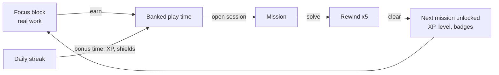
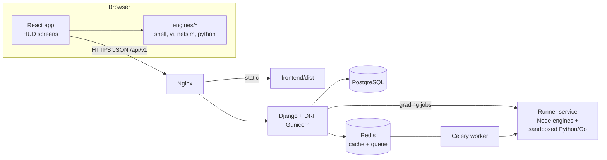
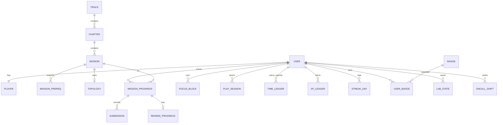

# Uptime Arcade: Design and Architecture

**Version:** 1.1 (2026-11-07)
**Owner:** raven
**Stack:** Django REST Framework + React (Vite), built on the *DRF React Foundation* template
**Status:** approved for build

---

## Contents

1. [How to use this document](#1-how-to-use-this-document)
2. [Vision and aim](#2-vision-and-aim)
3. [The core loop](#3-the-core-loop)
4. [Look and feel](#4-look-and-feel)
5. [Screens and routes](#5-screens-and-routes)
6. [Game systems](#6-game-systems)
7. [Learning design](#7-learning-design)
8. [Mission catalogue (200 at launch)](#8-mission-catalogue-200-at-launch)
9. [NetLab: the network simulator](#9-netlab-the-network-simulator)
10. [Simulation engines](#10-simulation-engines)
11. [System architecture](#11-system-architecture)
12. [Repository layout](#12-repository-layout)
13. [Content pipeline](#13-content-pipeline)
14. [Grading and trust](#14-grading-and-trust)
15. [Data model](#15-data-model)
16. [API](#16-api)
17. [Non-functional requirements](#17-non-functional-requirements)
18. [Testing strategy](#18-testing-strategy)
19. [Delivery plan (milestones)](#19-delivery-plan-milestones)
20. [Building it with Claude Code in VS Code](#20-building-it-with-claude-code-in-vs-code)
21. [Open questions](#21-open-questions)

---

## 1. How to use this document

- **What it is:** the single source of truth for what Uptime Arcade is and how it's built. Save it in the repository as `docs/DESIGN.md`.
- **Writing code:** each milestone in [section 19](#19-delivery-plan-milestones) is one unit of work with acceptance criteria. Build them in order.
- **Changing decisions:** edit this file in the same pull request, and record the reason as an ADR in `docs/adr/`.
- **Words used here:**

| Term | Meaning |
|---|---|
| Track | One skill path: Shell, vi, Python, Go, Networking, NetLab |
| Chapter | A group of missions inside a track that teach one idea |
| Mission | One lesson plus one task with a check |
| Rewind | Five review tasks that must be cleared to unlock the next mission |
| Operation | A multi-skill mission that combines several tracks |
| Focus block | A real-world work timer that earns play time |
| Session | Spending banked play time, the only time missions can be played |
| Cleared | Mission solved *and* its rewind finished |

---

## 2. Vision and aim

**Uptime Arcade turns real focus into play time, and spends that play time teaching real technical skills.**

The aim never changes, whatever features are added:

1. **Focus comes first.** You can only play with time earned by finishing real focus blocks. There's no free or unlimited play.
2. **Every minute of play teaches a usable skill.** Missions use real commands, real syntax and real networking behaviour, so the skills carry over to a job.
3. **Learning is step by step.** Each track starts at zero and builds one idea at a time. Nothing is used before it's taught.
4. **Practice is reinforced.** Rewind tasks make you recall what you just learned before you move on.
5. **It's honest and private.** It's a single-player game for self-improvement. Cheating only cheats yourself, but the server still guards the economy so the game stays meaningful.

**Who it's for:**
- The owner first: a security and ICT professional building shell, vi, Python, Go and networking depth.
- Later, students, junior sysadmins and network learners who want guided practice.

**The setting:** the player joins **Whiteraven**, a fictional cloud and network company, as a *Noob* and rises to *Archmage*. The story comes from departments (Support, SRE, Platform, Network, Security, Finance) that send tickets and incidents.

---

## 3. The core loop



1. Set a goal and start a focus block (15, 25 or 45 minutes) with your phone out of reach.
2. When the timer ends, confirm whether you finished the goal, and the server credits play time.
3. Open a session. Its clock runs on server time until the play time is used or you close it.
4. Read the lesson, then solve the mission in its tool (terminal, vi, Python, Go reader or NetLab).
5. Pass five rewind tasks to clear the mission and unlock the next one.
6. Earn XP, level up, and keep a daily streak for bonus rewards.

---

## 4. Look and feel

### 4.1 Direction

The look is a **holographic operator HUD set in a cinematic landscape**. The HUD is like the heads-up display in a sci-fi suit or a starship bridge: glowing cyan lines, amber highlights for things that matter, bracketed glass panels, and an animated reactor core at the centre of the home screen. It floats as a rounded glass window over a night world of jagged mountains, a still lake and a basalt plain split by lava. On the Deck, a hooded operator stands on the rock and projects the core into the sky.

Display titles are metallic with a slight chromatic split, edges are iridescent hairlines, and buttons are pills. The scene is painted in code from a seeded generator, so no image files ship. It's an original design for Whiteraven, so it uses no logos, characters or marks from any film, game or brand. See [ADR 0001](adr/0001-cinematic-holographic-look.md).

The look is calm when idle and lights up on achievement. Animation is used for moments that matter, such as level-ups, unlocks and the timer, never as constant noise.

### 4.2 Design tokens

These are carried over from the current game and defined once in `frontend/src/styles/tokens.css`:

| Token | Value | Use |
|---|---|---|
| `--void` | `#030a13` | Page background |
| `--glass` | `rgba(6,20,36,.68)` | Panel fill, dark enough for 4.5:1 text over lava |
| `--glass-strong` | `rgba(3,12,24,.86)` | Inputs, code, overlays |
| `--glass-sheen` | `rgba(150,214,255,.07)` | Light across the top of a panel |
| `--line` | `rgba(96,214,255,.34)` | Input borders, ring tracks |
| `--line-soft` | `rgba(170,214,255,.16)` | Panel and card borders |
| `--holo` | `#62dcff` | Primary accent, corner brackets, active nav |
| `--holo-soft` | `#a9ecff` | Secondary text accent, code |
| `--iris` | conic gradient, cyan through violet and amber | Iridescent hairlines on the frame and on hovered panels |
| `--metal` | vertical gradient, white to steel blue | Metallic display titles |
| `--text` | `#dcf4ff` | Body text |
| `--dim` | `#8db3c8` | Secondary text |
| `--amber` | `#ffb340` | Timer, objectives, rewards, warnings |
| `--lava`, `--lava-deep` | `#ff6a1f`, `#d22f08` | Warm light from the ground |
| `--ok` | `#6bf0b2` | Success, cleared |
| `--danger` | `#ff5d6c` | Errors, failed checks |
| `--on-accent` | `#031018` | Text on accent buttons |

| Role | Font | Fallback |
|---|---|---|
| Display and UI | **Oxanium** 400, 600, 800 | Segoe UI, system-ui |
| Code, terminal, consoles | **IBM Plex Mono** 400, 500, 700 | ui-monospace, Consolas |

Fonts are self-hosted from `frontend/public/fonts/`, so the game works offline.

### 4.3 Components (the HUD kit)

| Component | Description |
|---|---|
| `SceneBackdrop` | The painted landscape: a sharp copy inside the frame and a dimmed, zoomed copy behind it. `SceneThumb` paints small card images. |
| `OperatorFigure` | The player's silhouette on the Deck, with a projector beam and a floor plate. |
| `HudPanel` | Rounded glass panel with two glowing corner brackets (top left, bottom right) and an iridescent edge on hover. Optional title label in spaced uppercase. |
| `CoreRing` | The reactor: an SVG with a rotating dashed outer ring, a counter-rotating inner ring, a pulsing glow, and an amber arc showing progress to the next level. Shows the level number and title in the centre. |
| `TimerRing` | Big amber countdown with a circular progress arc, used on Focus. |
| `MissionNode` | A diamond on a track path. Locked is dim, open is a glowing cyan outline, rewind is amber, cleared is green. |
| `Meter` | Thin glowing bar with a label and value. |
| `Toast` | Bottom-centre amber notice that disappears after about 3.5 seconds. |
| `Overlay` | Full-screen dimmed layer for debriefs, level-ups and the finale. |
| `Terminal` | Monospace console with prompt, history, Tab completion and colour classes. |
| `ViEditor` | Full-pane modal editor with cursor, status bar and key counter. |
| `CodeEditor` | Python editor with a Run tests button and an output pane. |
| `TopologyCanvas` | NetLab map with devices, cables, link lights and packet animation. |
| `DeviceConsole` | A NetLab device CLI in a terminal, opened by clicking a device. |
| `Badge`, `LadderRow`, `StatTile` | Rewards screen pieces. |

### 4.4 Motion and sound

- **Idle:** the core rings rotate slowly (30 to 46 seconds per turn), the glow pulses every 3.2 seconds, and the lava's brightness breathes over 7 seconds.
- **Unlock:** the next node flashes from cyan to white to cyan, and a short rising chime plays.
- **Level-up:** a full-screen overlay scales up the new title with a bright glow, and a three-note chord plays.
- **Timer end:** a two-tone chime.
- **NetLab:** packets travel along cables as small glowing dots, green when delivered and red when dropped, with a reason shown.
- **Sound:** generated in the browser with Web Audio, so no files are needed. It's off until the first click, and a mute toggle is on System.
- **Reduced motion:** with `prefers-reduced-motion`, rotation, pulsing, lava breathing and packet animation stop, and state changes are instant.

### 4.5 Layout rules

- **Desktop:** the HUD fills a floating frame with no page scroll, and only panels scroll. Text-heavy screens dim the scene, and the Deck shows it at full strength.
- **Under 1040px:** the frame goes edge to edge, columns stack and the page scrolls over a fixed scene.
- **Under 400px:** everything still works, though NetLab shows a "best on a larger screen" note and allows pinch zoom.
- **Readability:** body text is at least 14px, and contrast is at least 4.5:1.

---

## 5. Screens and routes

Each screen is its own route, and the top bar shows the logo, navigation, level, XP, streak and the play-time or session clock.

| Route | Screen | Purpose |
|---|---|---|
| `/` | **Deck** | The core ring with your level, streak, today's focus, lifetime focus, next objective and progress on each track |
| `/focus` | **Focus** | Set a goal and length, check off "phone out of reach", see the running timer ring, log drifts, and claim when done |
| `/missions` | **Missions** | Six track columns with chapters and nodes, plus the Operations board and an on-call banner when unlocked |
| `/missions/:slug` | **Briefing** | Lesson and example, mission brief, sender, worth and par, plus the Launch button |
| `/missions/:slug/play` | **Play** | Mission panel on the left, workspace on the right (terminal, vi, Python, Go reader or NetLab) |
| `/missions/:slug/rewind` | **Rewind** | Five tasks with progress pips and feedback |
| `/ops` | **Operations** | Multi-skill missions with their prerequisites shown as linked track icons |
| `/oncall` | **On-call** | Endless incident shifts, unlocked after all track missions are cleared |
| `/rewards` | **Rewards** | Streak ladder, level ladder and badge grid |
| `/profile` | **Profile** | Stats, history charts (focus minutes per day, XP per week), name |
| `/system` | **System** | Sound, close session, new season, export or import of the offline save, logout |
| `/login`, `/register` | Auth | Styled in the HUD |

**Locks:**
- Play and Rewind need an active session. Without one, they show a panel with "Open session (MM:SS)" or "Go to Focus".
- When a focus block finishes, every screen sends you to Focus to claim it.

---

## 6. Game systems

All numbers live in one config file, `backend/apps/game/rules.py`, so balancing never needs a migration.

### 6.1 Focus economy

| Block | Play time | Goal bonus | XP |
|---|---|---|---|
| 15 min | 5:00 | +2:00 | 15 (+10 for the goal) |
| 25 min | 8:00 | +2:00 | 25 (+10 for the goal) |
| 45 min | 15:00 | +2:00 | 45 (+10 for the goal) |

- **Bank caps:** focus blocks can bank up to 30:00, and streak rewards can raise the bank to 60:00.
- **Starting bank:** 5:00, so a new player can try a mission right away.
- **Ending early:** earns nothing.
- **Drifts:** logging one is free. A block with zero drifts counts as a clean block.
- **Server time:** the server records `started_at` and `ends_at`, and a claim before `ends_at` on the server clock is rejected.

### 6.2 Sessions

- **Opening:** moves the whole bank into a session with `expires_at = now + bank`.
- **Closing:** returns the unused seconds to the bank.
- **Enforcement:** submissions for missions and rewinds are rejected with `409 no_active_session` when no session is active.

### 6.3 XP and scoring

| Event | XP |
|---|---|
| Mission solved | Base 100, 130 or 160 (first, middle and last third of the track), Operations 250 |
| Par bonus | +20: commands at or under par (shell and terminal goals), keys at or under par (vi), or first try (other check types) |
| Hint | −15 each, with a mission never worth less than 10 |
| Rewind task correct | 15, plus 5 if right the first time |
| On-call incident | 60, plus 100 per finished shift of five |
| Streak multiplier | +5% per streak day, up to +50% at 10 days, applied to all XP above |

### 6.4 Levels

Levels count **cleared** missions, so the ladder rewards finishing the rewind as well as solving. There are 200 launch missions.

| # | Title | Cleared |
|---|---|---|
| 1 | Noob | 0 |
| 2 | Initiate | 10 |
| 3 | Apprentice | 25 |
| 4 | Operator | 45 |
| 5 | Adept | 70 |
| 6 | Specialist | 95 |
| 7 | Technomancer | 120 |
| 8 | Sorcerer | 145 |
| 9 | Sage | 170 |
| 10 | Archmage | 200 |

The `peak` value remembers the highest count reached, so a new season never lowers your title.

### 6.5 Rewind

After a mission is solved, five tasks are generated for it:

| # | Type | Example |
|---|---|---|
| 1 | Concept (multiple choice) | Pick the key idea from four explanations taken from nearby missions |
| 2 | Fill the gap | `sort -k6 ____ api.log`, answer `-n` |
| 3 | Put it in order | Arrange pipeline parts, solution lines or vi keys |
| 4 | Which one fits | Choose the command, value or code that solved it |
| 5 | From memory | Type the answer or key line, with a "starts with" hint |

- A wrong answer shows the correct one and moves that task to the end of the queue, so every rewind ends with five correct answers.
- Rewind progress is saved, so you can leave and come back.
- Tasks are generated by the server from mission data. Authors can override any task in the mission YAML.

### 6.6 Unlock rules

- **Tracks:** a mission opens when the previous mission in its track is cleared. The first mission of each track is open from the start.
- **Operations:** each one lists prerequisite missions and opens when all of them are cleared.
- **On-call:** opens when every track mission is cleared.
- **NetLab:** its first mission needs Networking 11 (the local or gateway decision) to be cleared, because the lab assumes that idea.

### 6.7 Daily streaks

The streak grows by 1 on each calendar day (in the player's time zone) with at least one claimed focus block.

| Milestone | Play time | XP | Shield |
|---|---|---|---|
| 3 days | +5 min | +50 | |
| 7 days | +10 min | +150 | +1 |
| 14 days | +15 min | +300 | |
| 21 days | +15 min | +500 | +1 |
| 30 days | +20 min | +1000 | |
| 60 days | +30 min | +2000 | +1 |
| 100 days | +30 min | +5000 | +1 |

- **Rewards:** each milestone pays once per account.
- **Shields:** a shield covers one missed day and is used automatically. If more days were missed than shields held, the streak resets to 1 and the shields are kept.

### 6.8 Badges (launch set)

| Badge | Condition |
|---|---|
| First Block | Finish one focus block |
| Clean Ten | 10 blocks with no drifts |
| Ten Hours, Hundred Hours | 600 and 6000 focus minutes |
| Full Week, Iron Month, Centurion | 7, 30 and 100-day streaks |
| First Clear | Clear one mission |
| Shell, vi, Python, Go, Networking and NetLab Master | Clear the whole track |
| Operator of Operations | Clear all Operations |
| Par Hunter | 50 missions at or under par |
| No Hints Needed | Clear a whole chapter without hints |
| Night Shift | Finish 25 on-call incidents |
| Archmage | Clear all 200 launch missions |

### 6.9 Seasons and on-call

- **New season:** resets mission progress only. XP, level (via `peak`), streak and badges stay. The season number shows on Profile.
- **On-call:** shifts have five generated incidents (subnet maths, log queries, Go and Python tracing, NetLab micro-faults). Generation uses a server-side seed, so answers are never sent to the browser.

### 6.10 New content after launch

Content packs (section 13) add missions to existing tracks or new tracks. Archmage stays tied to the 200 launch missions. New packs add new badges and a "Mastery" rank shown as stars beside the title, one star for every 25 extra missions cleared.

---

## 7. Learning design

**Principles:**
1. **One new idea per mission.** The lesson teaches it with a tiny example on different data, and the mission makes you use it.
2. **Never use something before it's taught.** Every command, flag and keyword in a solution must appear in the same or an earlier lesson in that track, and CI checks this (section 18).
3. **Real material.** Real command syntax, real IOS-style network config and real Python and Go semantics. The fictional parts are only the company and its data.
4. **Spiral review.** Rewinds pull distractors from nearby missions, so you keep telling related ideas apart.
5. **Chapters end with a capstone** that combines the chapter's ideas.
6. **Operations combine tracks**, the way real incidents need several skills at once.

**Each mission has:**
- **From:** the sending department
- **Lesson:** a 1 to 3 sentence explanation and an example
- **Brief:** the situation
- **Goal:** the exact thing to achieve
- **Hints:** two, from gentle to specific
- **Debrief:** why it works, a worked answer, and where it's used on the job

---

## 8. Mission catalogue (200 at launch)

Six tracks of 30, plus 20 Operations. Each track is ordered for understanding, top to bottom. IDs are permanent, and new missions get new IDs (renumbering only changes the order field).

**Check types:**
- `answer`: submit a value
- `fs`: virtual file system state
- `vi`: file state, edited in vi, with a key-count par
- `py`: Python tests pass
- `go-out`: predict Go output
- `go-fix`: choose or type the fix that makes the program print the expected output
- `net`: NetLab state assertions
- `multi`: several checks in sequence

### 8.1 Shell (SH)

| ID | Chapter | Mission | You learn | Check |
|---|---|---|---|---|
| SH-01 | Getting around | Where am I? | `pwd`, `ls` | answer |
| SH-02 | Getting around | Moving between folders | `cd`, `..`, `~`, relative vs absolute paths | answer |
| SH-03 | Getting around | Read the welcome file | `cat`, `head`, `tail` | answer |
| SH-04 | Getting around | The file nobody can open | `ls -a`, quoting spaces, `./-name` | answer |
| SH-05 | Files | Set up a workspace | `mkdir -p`, `touch` | fs |
| SH-06 | Files | Copy, move, rename | `cp`, `mv` | fs |
| SH-07 | Files | Delete with care | `rm`, `rm -r`, why there's no undo | fs |
| SH-08 | Counting and finding | How much traffic today? | `wc -l` | answer |
| SH-09 | Counting and finding | Find the word | `grep`, `-i`, `-n` | answer |
| SH-10 | Counting and finding | Count and ignore | `grep -c`, `grep -v` | answer |
| SH-11 | Pipes | Your first pipe | `\|`, `head`, `tail` | answer |
| SH-12 | Pipes | Save the output | `>`, `>>`, `2>/dev/null` | fs |
| SH-13 | Columns | Take one column | `cut -d -f` | answer |
| SH-14 | Columns | Sort it out | `sort`, `-n`, `-r`, `-k`, `-u` | answer |
| SH-15 | Columns | The top-N counter | `sort \| uniq -c \| sort -rn \| head` | answer |
| SH-16 | System | Who can run this? | `ls -l`, `chmod`, rwx bits | fs |
| SH-17 | System | Search the tree | `find -name -type` | answer |
| SH-18 | System | Find and act | `find -exec`, `xargs` | fs |
| SH-19 | awk | Fields with awk | `$1`, `$NF`, `-F` | answer |
| SH-20 | awk | Filter and total | patterns, `END`, sums, averages | answer |
| SH-21 | awk | Group by | arrays, `for (k in a)` | answer |
| SH-22 | sed | Find and replace | `s/old/new/g`, escaping dots | fs |
| SH-23 | sed | Delete and print lines | `/re/d`, `-n 'Np'`, ranges | fs |
| SH-24 | Patterns | Regex basics | `grep -E`, `^ $ [] + ?` | answer |
| SH-25 | Patterns | Rearrange with groups | `sed -E` capture groups | fs |
| SH-26 | Patterns | Clean up characters | `tr`, Windows line endings | fs |
| SH-27 | Scripting | Variables and quoting | `VAR=`, `"$VAR"`, `$(cmd)` | answer |
| SH-28 | Scripting | Loop over files | `for`, `${f%.TXT}` | fs |
| SH-29 | Scripting | Read line by line, decide | `while read`, `if`, `&&`, `\|\|`, exit codes | fs |
| SH-30 | Scripting | Capstone: the daily report script | shebang, `$1`, `chmod +x`, combine everything | fs |

### 8.2 vi (VI)

| ID | Chapter | Mission | You learn | Check |
|---|---|---|---|---|
| VI-01 | Survival | Get in and out | `i`, `Esc`, `:wq`, `:q!` | vi |
| VI-02 | Survival | Walk the cursor | `h j k l` | vi |
| VI-03 | Survival | Jump by words | `w b e` | vi |
| VI-04 | Survival | Line edges | `0 ^ $` | vi |
| VI-05 | Survival | Top, bottom, line N | `gg G :N` | vi |
| VI-06 | Inserting | Add text anywhere | `a A o O I` | vi |
| VI-07 | Inserting | Fix one character | `x`, `r` | vi |
| VI-08 | Inserting | Take it back | `u`, `Ctrl-r` | vi |
| VI-09 | Operators | Delete smart | `dw dd D` | vi |
| VI-10 | Operators | Do it N times | counts: `3dd 5j 2w` | vi |
| VI-11 | Operators | Change in place | `cw cc C` | vi |
| VI-12 | Finding | Jump to a character | `f t ; ,` | vi |
| VI-13 | Finding | Search the file | `/ ? n N` | vi |
| VI-14 | Finding | Repeat the last change | `.` | vi |
| VI-15 | Copying | Copy and paste | `yy p P` | vi |
| VI-16 | Copying | Move a line | `dd` + `p` | vi |
| VI-17 | Copying | Join wrapped lines | `J` | vi |
| VI-18 | Copying | Fix the indent | `>> <<` | vi |
| VI-19 | Ex commands | Replace on one line | `:s/a/b/` | vi |
| VI-20 | Ex commands | Replace everywhere | `:%s/a/b/g` | vi |
| VI-21 | Ex commands | Work on ranges | `:10,20d`, `:.,$s` | vi |
| VI-22 | Precision | Text objects | `ciw di" da(` | vi |
| VI-23 | Precision | Visual selection | `v V` | vi |
| VI-24 | Precision | Column edits | `Ctrl-v` block insert | vi |
| VI-25 | Power | Named registers | `"ayy "ap` | vi |
| VI-26 | Power | Marks | `ma 'a` | vi |
| VI-27 | Power | Record a macro | `qa ... q @a @@` | vi |
| VI-28 | Power | Global commands | `:g/re/d`, `:v/re/d` | vi |
| VI-29 | Power | Several files | `:e`, `:w name`, `:r file` | vi |
| VI-30 | Capstone | Refactor the config under par | everything | vi |

### 8.3 Python (PY)

| ID | Chapter | Mission | You learn | Check |
|---|---|---|---|---|
| PY-01 | Basics | Hello, operator | `print`, strings, numbers | py |
| PY-02 | Basics | Name things | variables, `int str float bool` | py |
| PY-03 | Basics | Make a decision | `if elif else`, comparisons | py |
| PY-04 | Basics | Your first function | `def`, `return` | py |
| PY-05 | Strings | Clean user input | `strip lower replace` | py |
| PY-06 | Strings | Format a report line | f-strings, padding | py |
| PY-07 | Lists | Lists and indexes | `[]`, `[i]`, `[a:b]`, `len` | py |
| PY-08 | Lists | Loop over things | `for`, `range` | py |
| PY-09 | Lists | Loop until done | `while`, `break` | py |
| PY-10 | Dicts | Look things up | `{}`, keys, `in` | py |
| PY-11 | Dicts | Count anything | `d.get(k, 0) + 1` | py |
| PY-12 | Collections | Tuples and unpacking | `a, b = ...` | py |
| PY-13 | Collections | Sets for "seen" | `set`, dedupe | py |
| PY-14 | Collections | One-line lists | comprehensions | py |
| PY-15 | Collections | Sort by anything | `sorted(key=, reverse=)` | py |
| PY-16 | Functions | Flexible functions | defaults, keyword arguments | py |
| PY-17 | Functions | When things go wrong | `try except`, raising | py |
| PY-18 | Parsing | Split log lines | `split`, unpacking, `int()` | py |
| PY-19 | Parsing | Read and write JSON | `json.loads/dumps` | py |
| PY-20 | Parsing | Files the safe way | `with open` (virtual FS) | py |
| PY-21 | Stdlib | Counter and defaultdict | `collections` | py |
| PY-22 | Stdlib | Dates and times | `datetime`, `timedelta` | py |
| PY-23 | Stdlib | Patterns in text | `re.findall`, groups | py |
| PY-24 | Stdlib | Networks in code | `ipaddress` | py |
| PY-25 | Objects | Your first class | `class`, `__init__`, methods | py |
| PY-26 | Objects | Data classes | `@dataclass` | py |
| PY-27 | Objects | Lazy sequences | generators, `yield` | py |
| PY-28 | Quality | Test your code | `assert`, test functions | py |
| PY-29 | Algorithms | Merge the windows | sort then sweep | py |
| PY-30 | Capstone | The log analyser | parse, aggregate, percentile, report | py |

### 8.4 Go (GO)

| ID | Chapter | Mission | You learn | Check |
|---|---|---|---|---|
| GO-01 | Basics | Hello, Whiteraven | `package main`, `func main`, `fmt.Println` | go-out |
| GO-02 | Basics | Zero values | `var`, `:=`, defaults | go-out |
| GO-03 | Basics | Types and conversion | `int`, `float64`, `string()`, `strconv` | go-out |
| GO-04 | Basics | Constants and iota | `const`, `iota` | go-out |
| GO-05 | Flow | Decisions | `if` with init, `switch` without fallthrough | go-out |
| GO-06 | Flow | The only loop | `for` in three forms, `range` | go-out |
| GO-07 | Functions | Many returns | multiple results, named results | go-out |
| GO-08 | Functions | Errors are values | `if err != nil` | go-fix |
| GO-09 | Slices | Arrays vs slices | fixed vs dynamic | go-out |
| GO-10 | Slices | Grow with append | `len`, `cap` | go-out |
| GO-11 | Slices | The slice that changed by itself | shared backing arrays | go-out |
| GO-12 | Slices | Copy safely | `copy`, full slice expressions | go-fix |
| GO-13 | Maps | Look up with comma-ok | `v, ok := m[k]`, nil maps | go-out |
| GO-14 | Text | Bytes and runes | UTF-8, `[]rune` | go-out |
| GO-15 | Types | Structs | fields, literals | go-out |
| GO-16 | Types | Value vs pointer receivers | methods | go-out |
| GO-17 | Types | Interfaces | implicit satisfaction | go-out |
| GO-18 | Types | The nil that isn't nil | interface holding a nil pointer | go-fix |
| GO-19 | Cleanup | defer order and arguments | LIFO, evaluation time | go-out |
| GO-20 | Cleanup | panic and recover | when and why | go-out |
| GO-21 | Errors | Wrap and inspect | `%w`, `errors.Is/As` | go-out |
| GO-22 | Packages | Exported names | capital letters, packages | go-fix |
| GO-23 | Concurrency | Goroutines | `go f()`, why main exits early | go-out |
| GO-24 | Concurrency | Channels | unbuffered vs buffered | go-out |
| GO-25 | Concurrency | Close and drain | `close`, `range ch` | go-out |
| GO-26 | Concurrency | Select and timeouts | `select`, `time.After`, `default` | go-out |
| GO-27 | Concurrency | Share safely | `sync.WaitGroup`, `Mutex` | go-fix |
| GO-28 | Concurrency | Cancel work | `context.WithTimeout` | go-out |
| GO-29 | Quality | Table tests | `testing`, predict which cases fail | go-out |
| GO-30 | Capstone | The worker pool | design, predict, fix a race | go-fix |

When the sandboxed runner ships (M9), `go-fix` missions upgrade to *write and run* missions with real `go test`.

### 8.5 Networking (NET): concepts and host tools

| ID | Chapter | Mission | You learn | Check |
|---|---|---|---|---|
| NET-01 | Addresses | What an IP really is | 32 bits, dotted decimal | answer |
| NET-02 | Addresses | Binary to decimal | octet place values | answer |
| NET-03 | Addresses | Prefix and mask | `/24` = `255.255.255.0` | answer |
| NET-04 | Subnets | Hosts in a subnet | `2^h − 2`, /31 and /32 | answer |
| NET-05 | Subnets | Network and broadcast | block size | answer |
| NET-06 | Subnets | Size it right | smallest prefix for N hosts | answer |
| NET-07 | Subnets | Private and special ranges | RFC 1918, CGNAT, loopback | answer |
| NET-08 | Subnets | Carve one /24 | VLSM, largest first | answer |
| NET-09 | Subnets | One route for four | summarisation | answer |
| NET-10 | Local network | MACs and ARP | layer 2 vs 3 | answer |
| NET-11 | Local network | Local or via the gateway? | the host's decision | answer |
| NET-12 | Transport | Ports and sockets | IP plus port | answer |
| NET-13 | Transport | The TCP handshake | SYN, SYN-ACK, ACK, states | answer |
| NET-14 | Transport | TCP or UDP? | trade-offs | answer |
| NET-15 | Transport | Ports you must know | 22, 53, 80, 443, 25, 3389 and more | answer |
| NET-16 | Services | DNS records | A, AAAA, CNAME, MX, TXT, NS | answer |
| NET-17 | Services | Follow a DNS lookup | `dig`, `resolv.conf` | fs |
| NET-18 | Services | How DHCP hands out addresses | DORA | answer |
| NET-19 | Routing | Read a routing table | longest prefix match | answer |
| NET-20 | Routing | The PC with no internet | `ip addr`, `ip route`, netplan | fs |
| NET-21 | Tools | Read ping | ICMP, TTL, loss | answer |
| NET-22 | Tools | Read traceroute | where the delay starts | answer |
| NET-23 | Tools | Who is listening? | `ss -tulpn` | answer |
| NET-24 | Tools | Talk HTTP by hand | `curl -I`, status codes, headers | answer |
| NET-25 | Edge | Read the NAT table | PAT mappings | answer |
| NET-26 | Edge | First match wins | firewall rule order | answer |
| NET-27 | Edge | TLS at a glance | certificates, expiry, `openssl s_client` | answer |
| NET-28 | Modern | IPv6 basics | shortening, `/64`, link-local | answer |
| NET-29 | Planning | How long will it take? | bits vs bytes, throughput | answer |
| NET-30 | Capstone | The troubleshooting ladder | layered diagnosis across tools | multi |

### 8.6 NetLab (LAB): simulated devices

Each lab loads a topology and gives you device consoles. You pass when every goal assertion holds (section 9.6).

| ID | Chapter | Lab | You learn | Check |
|---|---|---|---|---|
| LAB-01 | First contact | Two PCs, one cable | cabling, host IPs, `ping` | net |
| LAB-02 | First contact | The switch learns | MAC learning, `show mac address-table` | net |
| LAB-03 | Console | Talk to a device | `enable`, `configure terminal`, `hostname`, `show running-config` | net |
| LAB-04 | Console | Wake the interface | `interface`, `ip address`, `no shutdown`, `description` | net |
| LAB-05 | Console | Make it stick | `copy running-config startup-config`, `reload` | net |
| LAB-06 | Routing basics | Join two networks | router interfaces in two subnets | net |
| LAB-07 | Routing basics | Gateways for everyone | host default gateways | net |
| LAB-08 | VLANs | Create VLANs | `vlan 10`, `name`, `show vlan brief` | net |
| LAB-09 | VLANs | Access ports | `switchport mode access`, `switchport access vlan` | net |
| LAB-10 | VLANs | Trunk between switches | `switchport mode trunk`, `allowed vlan` | net |
| LAB-11 | VLANs | Fault: the lost VLAN | trunk allowed list missing a VLAN | net |
| LAB-12 | VLANs | Router on a stick | sub-interfaces, `encapsulation dot1q` | net |
| LAB-13 | Routing | Static routes | `ip route` | net |
| LAB-14 | Routing | Way out to the ISP | default route | net |
| LAB-15 | Routing | Fault: the wrong route wins | longest prefix match in practice | net |
| LAB-16 | Services | DHCP on the router | `ip dhcp pool`, `network`, `default-router`, `dns-server`, `ip dhcp excluded-address` | net |
| LAB-17 | Services | DHCP across VLANs | `ip helper-address` | net |
| LAB-18 | Services | Name resolution | lab DNS server records, host resolver | net |
| LAB-19 | Security | Standard ACL | `access-list 10`, `ip access-group` | net |
| LAB-20 | Security | Extended ACL | block guests from finance, allow web | net |
| LAB-21 | Security | Fault: rule order | first match wins | net |
| LAB-22 | Edge | NAT overload | `ip nat inside/outside`, `overload` | net |
| LAB-23 | Edge | Port forwarding | static NAT for a server | net |
| LAB-24 | Dynamic routing | OSPF in one area | `router ospf 1`, `network ... area 0` | net |
| LAB-25 | Dynamic routing | Survive a cut cable | OSPF reconverges, `show ip route` | net |
| LAB-26 | Switching safety | The broadcast storm | spanning tree, blocked ports | net |
| LAB-27 | Switching safety | Port security | `switchport port-security`, maximum, sticky | net |
| LAB-28 | Layer 3 switching | Route on the switch | `ip routing`, SVIs (`interface vlan 10`) | net |
| LAB-29 | Build | The four-floor office | VLANs, DHCP, inter-VLAN routing, ACLs, NAT from a blank lab | net |
| LAB-30 | Capstone | Blackout | five injected faults, restore every service under a timer | net |

### 8.7 Operations (OPS): multi-skill missions

Each Operation has 2 to 4 stages, each in a different tool. The state carries across stages, so what you find in the logs is what you fix in the lab.

| ID | Operation | Skills | Stages | Opens after |
|---|---|---|---|---|
| OPS-01 | Who broke the Wi-Fi? | Shell, NetLab | awk the DHCP log for a rogue MAC, then enable port security on that port | SH-21, LAB-27 |
| OPS-02 | Config drift | Shell, vi, NetLab | `diff` two switch configs, fix the saved copy in vi, apply it on the switch | SH-29, VI-14, LAB-10 |
| OPS-03 | Subnet planner | Python, NetLab | write `plan(needs)` with `ipaddress`, then apply the plan to three VLANs | PY-24, LAB-12 |
| OPS-04 | Latency report | Shell, Python | extract timings with awk, compute p95 in Python | SH-20, PY-21 |
| OPS-05 | DNS outage | Networking, vi, NetLab | `dig` shows timeouts, fix `resolv.conf` in vi, fix the lab DNS record | NET-17, VI-11, LAB-18 |
| OPS-06 | Shadowed rules | Python, NetLab | parse an ACL and find rules that can never match, then reorder on the router | PY-23, LAB-21 |
| OPS-07 | Inventory sync | Shell, Python | `cut` and `sort -u` hosts, then a JSON inventory diff in Python | SH-15, PY-19 |
| OPS-08 | Nightly backup | Shell, vi | write the backup script, add the cron line in vi, test it | SH-30, VI-20 |
| OPS-09 | The racing health checker | Go, Networking | predict the race, choose the fix, read which ports failed | GO-27, NET-15 |
| OPS-10 | Certificate sweep | Networking, Python | read certificate expiry dates, compute days left with `datetime` | NET-27, PY-22 |
| OPS-11 | The noisy client | Shell, Python, NetLab | find the top talker, simulate the rate limit, block it with an ACL | SH-21, PY-29, LAB-20 |
| OPS-12 | VLAN migration | Python, NetLab | generate switch config from CSV, paste it into the lab, verify with ping | PY-20, LAB-10 |
| OPS-13 | Disk full | Shell | find big files, delete safely, script the cleanup | SH-18, SH-29 |
| OPS-14 | Bad deploy | Shell, vi, Go | `diff` versions, fix in vi, predict the version comparison | SH-29, VI-21, GO-21 |
| OPS-15 | Guest isolation audit | NetLab, Python | ping matrix in the lab, write the report function | LAB-20, PY-25 |
| OPS-16 | Log rotation | Shell, vi | sed and awk, a loop, permissions, a config in vi | SH-28, VI-27 |
| OPS-17 | ISP failover | NetLab, Networking | floating static routes, verify with traceroute | LAB-14, NET-22 |
| OPS-18 | Branch office | Networking, NetLab | plan the subnets, then build VLANs, DHCP and NAT | NET-08, LAB-29 |
| OPS-19 | Port audit | Networking, Go | read `ss` output, predict the scanner's output, close what shouldn't listen | NET-23, GO-26 |
| OPS-20 | Final exam: Total Recall | All six | a five-stage incident across every tool | All track capstones |

---

## 9. NetLab: the network simulator

### 9.1 Goals

- **Real enough to transfer:** the CLI syntax and behaviour follow Cisco IOS conventions, which is what network courses and jobs use. The command set is limited and documented in-game.
- **Fun:** you see packets move, links light up, and outages happen and get fixed.
- **Deterministic:** the same config always gives the same result, so missions can be graded and tested in CI.
- **Pure JavaScript, with no React inside the engine:** the same engine runs in the browser, in tests, and in the grading runner (Node).

### 9.2 Devices

| Device | Ports | Capabilities |
|---|---|---|
| PC, laptop | `eth0` | IP config (static or DHCP), gateway, DNS. Commands: `ipconfig`, `ping`, `tracert`, `nslookup` |
| Server | `eth0` | As a PC, plus services: DNS, HTTP, DHCP (optional) |
| Switch (L2) | `Gi0/1` to `Gi0/24` | VLANs, access and trunk ports, MAC table, STP, port security |
| Switch (L3) | `Gi0/1` to `Gi0/24` | L2 features plus `ip routing`, SVIs, static routes, OSPF |
| Router | `Gi0/0` to `Gi0/3` | Interfaces, sub-interfaces, static routes, OSPF, ACLs, NAT, DHCP server and relay |
| Cloud (ISP) | `Gi0/0` | Fixed upstream with a public range and an "internet" host at `198.51.100.10` |
| Wireless AP | `Gi0/1` + SSIDs | Maps each SSID to a VLAN (simplified) |

### 9.3 CLI modes and commands (v1)

Modes work like IOS: `Router>` (user), `Router#` (privileged), `Router(config)#`, `Router(config-if)#`, `Router(config-subif)#`, `Router(config-vlan)#`, `Router(config-router)#`, `Router(dhcp-config)#`.

**Shared behaviour:**
- Unique abbreviations are accepted (`conf t`, `int g0/1`, `sh ip int br`).
- `?` shows the valid next words, and Tab completes.
- `no <command>` negates a command.
- `do <command>` runs an exec command from config mode.
- `end` or `Ctrl-Z` returns to privileged mode, and `exit` goes up one level.
- Errors match IOS style: `% Invalid input detected at '^' marker.`

| Area | Commands |
|---|---|
| Exec | `enable`, `disable`, `configure terminal`, `show running-config`, `show startup-config`, `show ip interface brief`, `show interfaces`, `show vlan brief`, `show interfaces trunk`, `show mac address-table`, `show ip route`, `show ip arp`, `show access-lists`, `show ip nat translations`, `show ip dhcp binding`, `show ip ospf neighbor`, `show spanning-tree`, `show port-security`, `ping`, `traceroute`, `copy running-config startup-config`, `write memory`, `reload`, `clear ip nat translation *` |
| Global config | `hostname`, `interface`, `vlan`, `ip route`, `ip routing`, `router ospf`, `access-list`, `ip access-list extended`, `ip nat inside source`, `ip nat inside source static`, `ip dhcp pool`, `ip dhcp excluded-address`, `spanning-tree mode`, `enable secret`, `banner motd` |
| Interface | `ip address`, `shutdown` and `no shutdown`, `description`, `switchport mode access` and `trunk`, `switchport access vlan`, `switchport trunk allowed vlan [add\|remove]`, `switchport trunk native vlan`, `encapsulation dot1q`, `ip helper-address`, `ip access-group in\|out`, `ip nat inside\|outside`, `switchport port-security` (`maximum`, `mac-address sticky`, `violation`), `spanning-tree portfast` |
| Router OSPF | `network <ip> <wildcard> area <n>`, `router-id`, `passive-interface` |
| DHCP pool | `network`, `default-router`, `dns-server`, `lease` |

### 9.4 Engine model

```text
engines/netsim/
  model/       Device, Interface, Link, Vlan, Route, Acl, NatRule, DhcpPool
  cli/         mode state machine, tokenizer, abbreviation matcher, per-mode command table
  config/      running config <-> model (show run printer and config parser are inverses)
  l2/          frame switching: MAC learning, flooding, VLAN tags, trunks, STP
  l3/          ARP, IP forwarding with longest prefix match, TTL, ICMP
  services/    DHCP (DORA), DNS, HTTP stub, NAT/PAT, ACL evaluation
  routing/     static, connected, OSPF (link-state database + SPF), administrative distance
  sim/         discrete-event scheduler: tick(), step(), run-until-idle; event log for animation
  faults/      injectors: cut link, shut port, remove VLAN, wrong mask, bad route, ACL above permit
  check/       goal assertions used by missions and tests
```

- **Determinism:** time is simulated in ticks, events are ordered `(tick, sequence)`, and any random parts (such as port numbers) come from a seeded RNG.
- **Event log:** every frame or packet step is recorded: `{tick, device, port, action: forward|flood|drop|deliver, reason}`. The UI animates from this log. "Simulation mode" lets you step through events one by one, like a debugger for packets.
- **Simplifications, documented in-game:**
  - OSPF computes routes after a short convergence delay, without real timers.
  - STP elects the root by bridge priority and MAC, with no timer states.
  - Wi-Fi is just an SSID-to-VLAN mapping.
- **Saving:** a lab is saved as running configs, startup configs, cable list and device positions, all as text and JSON.

### 9.5 Topology canvas (UI)

- Devices are icons on a grid. In sandbox mode you can drag devices from a palette, and in missions the topology is fixed unless the goal says otherwise.
- To cable, click a port, then another port. The link light is amber while negotiating, green when up and red when down.
- Click a device to open its console in a dockable panel. Several consoles can be open at once as tabs.
- The top bar has Realtime / Simulation mode, Step, Play, a speed control and Reset lab.
- Packets animate along links. Hover a dropped packet to see the reason, such as `ACL 110 line 20 deny` or `no route to 10.40.50.0`.

### 9.6 Grading labs

Each lab YAML lists goals as assertions that the `check/` module evaluates against the engine:

```yaml
goals:
  - reach: {from: PC-ENG-1, to: SRV-WEB, proto: icmp}          # must succeed
  - reach: {from: GUEST-1, to: PC-FIN-1, proto: tcp, port: 445, expect: blocked}
  - reach: {from: PC-ENG-1, to: INTERNET, proto: tcp, port: 443}
  - config: {device: SW1, contains: "switchport trunk allowed vlan 10,20,30,40", interface: Gi0/24}
  - dhcp_lease: {host: PC-ENG-2, in: 10.40.30.0/24}
  - saved: {device: R1}                                         # startup config matches running
```

The Check button runs all goals and shows each one as a pass or fail with the reason, so the lab itself teaches you.

### 9.7 Sandbox

`/netlab/sandbox` is a free-build lab with no mission. It's available during sessions only, and it costs session time like everything else, so the economy stays intact.

---

## 10. Simulation engines

All engines are framework-free JavaScript in `engines/`, imported by React through thin wrapper components and run by the grading runner in Node.

| Engine | Source today | Plan |
|---|---|---|
| `shell` | `shell.js` + `commands.js` (pipes, redirects, globbing, loops, if, awk interpreter, sed, about 50 tools) | Port to modules. Add `less`, `ss`, `curl` stubs, `$1` script arguments and `test`/`[ ]`. Expose `createShell({fs, net}) -> {run(line), state}` |
| `fs` | Map-based virtual file system with overlay | Separate module. Fixtures are loaded from YAML |
| `vi` | `vi.js` (modes, motions, operators, counts, dot-repeat, search, `:s`, `>>`) | Add text objects, visual and block mode, registers, marks, macros, `:g` and ranges, as VI-22 to VI-29 require |
| `python` | Skulpt in the browser | Keep Skulpt for instant feedback, and re-run tests server-side in the sandbox once M9 ships |
| `go` | Predict-only today | v1: `go-out` and `go-fix` with outputs verified in CI by real `go run`. v2: sandboxed runner executes player code |
| `netsim` | New | As described in section 9 |
| `rewind` | `rewind.js` | Move generation to the server (Python port) so answers stay server-side |

---

## 11. System architecture



| Part | Responsibility |
|---|---|
| React app | Screens, HUD components, running engines for instant feedback, calling the API |
| Django + DRF | Accounts, content, player state, economy, grading orchestration, admin |
| PostgreSQL | All persistent data |
| Redis (from M5) | Cache for content lists, Celery broker, rate limiting |
| Celery worker (from M9) | Runs slow grading jobs asynchronously |
| Runner service (M9) | Re-verifies state-based submissions with the same JS engines in Node, and runs Python and Go in a sandbox (container per job, no network, CPU, memory and time limits, read-only root, seccomp) |
| Nginx | TLS, static files, proxying, security headers |

**Backend apps** (each in `backend/apps/`):

| App | Owns |
|---|---|
| `accounts` | User, login, profile basics (from the foundation) |
| `content` | Tracks, chapters, missions, rewind templates, topologies, fixtures, content packs, the import command |
| `game` | Player state, rules config, XP and play-time ledgers, levels, streaks, badges, seasons |
| `focus` | Focus blocks, sessions, drift log |
| `missions` | Mission progress, submissions, grading, hints, debriefs |
| `rewind` | Rewind generation, progress and answers |
| `netlab` | Saved lab states, sandbox labs |
| `oncall` | Shifts, seeded incident generation |
| `core` | Shared base models, errors, pagination, health (from the foundation) |

**Frontend features** (each in `frontend/src/features/`):
`auth`, `deck`, `focus`, `missions`, `briefing`, `play` (with `workspaces/terminal|vi|python|go|netlab`), `rewind`, `ops`, `oncall`, `rewards`, `profile`, `system`.

The shared HUD kit lives in `frontend/src/ui/`.

---

## 12. Repository layout

```text
uptime-arcade/
├── backend/                          Django + DRF (from the foundation)
│   ├── config/settings/{base,dev,test,prod}.py
│   ├── apps/{core,accounts,content,game,focus,missions,rewind,netlab,oncall}/
│   └── templates/app_template/
├── frontend/                         React + Vite
│   ├── public/fonts/                 Oxanium, IBM Plex Mono (self-hosted)
│   └── src/
│       ├── api/client.js
│       ├── app/App.jsx               routes
│       ├── ui/                       HudPanel, CoreRing, TimerRing, MissionNode, Toast, Overlay, ...
│       │   └── scene/                  the landscape painter
│       ├── styles/tokens.css         design tokens from section 4.2
│       ├── features/<feature>/
│       └── sound/                    Web Audio cues
├── engines/                          framework-free JS, shared by frontend and runner
│   ├── package.json
│   ├── fs/  shell/  vi/  netsim/  rewind-preview/
│   └── test/                         Vitest for every engine
├── runner/                           grading service (M9): Node + sandbox launcher
├── content/                          the curriculum, as data
│   ├── schema/mission.schema.json
│   ├── tracks.yaml
│   ├── legacy/                       the 100 legacy missions as JS, until M1 converts them (ADR 0002)
│   ├── missions/{shell,vi,python,go,networking,netlab,ops}/*.yaml
│   ├── fixtures/fs/*.yaml            virtual files per mission or shared
│   ├── topologies/*.yaml             NetLab labs
│   └── packs/                        post-launch content packs
├── tools/
│   ├── verify_content.mjs            runs every solution through the engines
│   ├── check_taught_before_used.py   lesson order check (section 18)
│   └── verify_go.sh                  runs every Go snippet with real `go run`
├── legacy/                           the original single-file game, for reference
├── docs/
│   ├── DESIGN.md                     this document
│   ├── ROADMAP.md  ARCHITECTURE.md  CONVENTIONS.md  DEPLOYMENT.md
│   └── adr/
├── deploy/  .github/  .vscode/
├── CLAUDE.md
└── Makefile
```

---

## 13. Content pipeline

**Content is code.** Missions are YAML files reviewed in pull requests and checked in CI, then imported into the database.

### 13.1 Mission YAML

```yaml
id: SH-15
slug: top-n-counter
track: shell
chapter: Columns
order: 15
title: The top-N counter
from: Product
xp: 130
check: answer
par: {kind: commands, value: 1}
lesson:
  text: uniq -c counts repeats, but only next to each other, so sort first. Sort again with -rn to put the biggest count on top.
  example: cut -d' ' -f1 visits.log | sort | uniq -c | sort -rn
brief: Product wants the busiest API path in ~/logs/api-access.log.
goal: "Run: submit <path>"
fixtures: [api-access-log]
answer:
  accept: ["/v1/orders"]          # server-only, never sent to the browser
  normalize: [trim, collapse_space]
hints:
  - cut the path column.
  - sort | uniq -c | sort -rn is the classic counter.
debrief:
  why: sort | uniq -c | sort -rn is the most useful shell idiom you'll learn.
  solution: cut -d' ' -f4 ~/logs/api-access.log | sort | uniq -c | sort -rn | head -1
  job: You'll type this pipeline for the rest of your career.
teaches: [sort, uniq -c, sort -rn, head]
uses: [cut, sort, uniq, head]
rewind_overrides: {}             # optional hand-written tasks
```

`fs` missions replace `answer` with `expect` rules (`file_equals`, `file_exists`, `file_missing`, `mode_has`, `script_ran`). `net` missions use `topology` and `goals`, and `py` missions use `starter` and `tests`.

### 13.2 Flow

1. An author edits YAML.
2. CI validates against `mission.schema.json`.
3. `tools/verify_content.mjs` runs every solution through the engines, and `verify_go.sh` runs Go snippets.
4. `check_taught_before_used.py` confirms every `uses` item was taught earlier in the track.
5. On merge, deploy runs `manage.py import_content`, which upserts by `id`, bumps `content_version` and never deletes progress (removed missions are marked `retired`).

### 13.3 Migrating the existing 100 missions

The legacy JS (`t_shell.js`, `t_rest.js`, `learn.js`) is converted to YAML by a one-off script, `tools/legacy_to_yaml.mjs`. Missions are then renumbered and gaps filled to reach the 200 in section 8. Legacy missions are mapped to their closest new IDs, which is recorded in `content/LEGACY_MAP.md`.

---

## 14. Grading and trust

| Check | Where it's graded | What the browser gets |
|---|---|---|
| `answer` | Server compares the normalized submission with `accept` | Never the answer, only a pass or fail |
| `fs`, `vi` | v1: browser engine checks and sends the final files plus a command or key log. M9: runner replays the log and re-checks | Expect rules stay server-side, and the browser receives only "goal met" signals from the engine |
| `py` | v1: Skulpt in the browser runs the tests, and the server stores the code. M9: sandbox re-runs the tests | Test cases are visible, which is part of learning |
| `go-out`, `go-fix` | Server, like `answer` | Code only |
| `net` | v1: browser engine evaluates goals and submits configs. M9: runner rebuilds the lab from configs and re-checks | Goal list is visible, and pass logic runs in the shared engine |

- **Debrief:** the solution and debrief come from `GET /missions/:id/debrief/`, which only works once the mission is solved.
- **Threat model:** this is a single-player game, so client-side cheating mostly cheats the player. The server still controls everything that matters for the aim: time, play-time balance, session validity, XP, unlocks and streaks. Server-side re-verification (M9) is required before any leaderboard or shared feature.

---

## 15. Data model



| Model | Key fields |
|---|---|
| `Player` | user (1:1), xp, peak_cleared, season, streak, best_streak, shields, last_streak_day, time_zone, sound_on |
| `Track` | code (SH, VI, PY, GO, NET, LAB, OPS), name, subtitle, order |
| `Chapter` | track, name, order |
| `Mission` | code (SH-15), slug, track, chapter, order, title, from_dept, check_type, xp, par_kind, par_value, lesson_text, lesson_example, brief, goal, hints (JSON), debrief (JSON, server-only), answer_spec (JSON, server-only), starter (JSON), fixtures (JSON), topology (FK), teaches (JSON), content_version, status (draft, published, retired) |
| `MissionPrereq` | mission, requires |
| `Topology` | code, yaml, version |
| `MissionProgress` | user, mission, season, state (open, solved, cleared), tries, hints_used, commands, keys, xp_awarded, solved_at, cleared_at. Unique on (user, mission, season) |
| `Submission` | progress, payload (JSON), result, detail, created_at |
| `RewindProgress` | progress (1:1), tasks (JSON, generated), queue (JSON), correct, misses (JSON) |
| `FocusBlock` | user, goal, minutes, started_at, ends_at, claimed_at, outcome (done, not_done, abandoned), drifts |
| `PlaySession` | user, opened_at, expires_at, closed_at, returned_seconds |
| `TimeLedger` | user, delta_seconds, reason (focus, goal_bonus, streak, session_open, session_return, starter), ref_type, ref_id, created_at. **Bank = sum** |
| `XPLedger` | user, delta, reason, multiplier, ref_type, ref_id, created_at. **XP = sum**, cached on Player |
| `StreakDay` | user, date. Unique together |
| `StreakReward` | user, milestone, claimed_at |
| `Badge`, `UserBadge` | code, name, description; user, badge, earned_at |
| `LabState` | user, mission (nullable for sandbox), state (JSON), updated_at |
| `OnCallShift` | user, seed, started_at, finished_at, incidents (JSON, answers server-only), correct |

**Why ledgers:** play time and XP are never edited in place. Each change is a ledger row, so balances can be audited, rebuilt and explained, which is the same idea as accounting.

---

## 16. API

All endpoints are under `/api/v1/`, need login unless marked public, and use the foundation's error format.

| Method | Path | Purpose |
|---|---|---|
| POST | `auth/register/`, `auth/login/`, `auth/refresh/`, `auth/logout/` | Foundation auth (public) |
| GET, PATCH | `auth/me/` | Account |
| GET | `player/` | Level, XP, bank, session, streak, shields, badges summary |
| GET | `tracks/` | Tracks, chapters and missions with the player's state per mission |
| GET | `missions/{code}/` | Briefing: lesson, brief, goal, par, worth, state |
| GET | `missions/{code}/play/` | Play payload: fixtures, starter, topology, hints already revealed. **Needs a session** |
| POST | `missions/{code}/hint/` | Reveal the next hint and charge XP. **Session** |
| POST | `missions/{code}/submit/` | `{answer}`, `{files, log}`, `{code}` or `{configs}` returns pass or fail and XP. **Session** |
| GET | `missions/{code}/debrief/` | Why, solution, job. Only after it's solved |
| GET | `missions/{code}/rewind/` | Current task (without its answer), progress |
| POST | `missions/{code}/rewind/answer/` | `{value}` returns correct, the correct answer if wrong, the next state, and unlock or level events. **Session** |
| POST | `focus/blocks/` | Start a block `{goal, minutes}` |
| POST | `focus/blocks/{id}/drift/` | Log a drift |
| POST | `focus/blocks/{id}/abandon/` | End early |
| POST | `focus/blocks/{id}/claim/` | `{done: bool}`, allowed after `ends_at`. Returns time earned, XP, streak events, badges |
| GET | `focus/blocks/?range=30d` | History for Profile charts |
| POST | `sessions/open/` | Opens with the full bank |
| POST | `sessions/close/` | Returns unused seconds |
| GET | `rewards/` | Streak ladder, levels and badges with the player's status |
| GET, PUT | `netlab/{code}/state/` | Load or save lab state |
| POST | `oncall/shifts/` | Start a shift |
| GET | `oncall/shifts/current/` | Current incident without its answer |
| POST | `oncall/shifts/current/answer/` | Answer the current incident |
| POST | `seasons/new/` | Start a new season |
| GET | `export/`, POST `import/` | Bring progress from the offline game |
| GET | `health/` | Public health check |

**Responses carry events:** every mutating game endpoint returns an `events` array, such as `[{type: "level_up", level: 4, title: "Operator"}, {type: "unlocked", mission: "SH-16"}]`. The UI plays animations from these, so the server stays the source of truth for what happened.

---

## 17. Non-functional requirements

| Area | Requirement |
|---|---|
| Performance | First load under 2.5s on 4G. Screen changes under 100ms. API p95 under 200ms excluding grading. NetLab handles 30 devices at 60fps |
| Availability | 99% monthly for a hobby service. The game shell is cached for offline viewing via a service worker (M11) |
| Security | Foundation baseline, server-held answers, session-gated play, rate limits (submit 30/min, auth 10/min), Argon2 password hashing in production, admin limited by IP, sandbox isolation for the runner (no network, resource limits, fresh container per job) |
| Privacy | Stores email, display name, focus goals and history only. Account delete wipes everything. Data export is available |
| Accessibility | Keyboard reachable everywhere, visible focus, reduced motion, 4.5:1 contrast, labelled controls. Terminal and consoles support screen readers through a live region |
| Time | All day boundaries use the player's time zone (default `Africa/Dar_es_Salaam`) |
| Compatibility | Latest Chrome, Firefox and Edge. Phone layout works, and NetLab is best on a large screen |

---

## 18. Testing strategy

| Layer | Tests |
|---|---|
| Rules (`game`) | Pure functions for streak gaps and shields, level from cleared count, XP multiplier, bank caps. Includes property tests (Hypothesis) for the ledgers |
| API | Every endpoint: login required, session required where marked, ownership, error shape, events emitted |
| Economy | Claims before `ends_at` are rejected, double claims are rejected, a session can't be opened twice, close returns the right seconds |
| Engines | Vitest for each command and behaviour. NetLab golden tests: topology plus configs give the expected reachability matrix |
| Content | **Every mission's solution passes in CI** (port of the legacy Playwright playthrough to engine-level scripts), all Go outputs are checked with real `go run`, and the taught-before-used check passes |
| End to end | Playwright on a fresh account: focus block (with a faked clock) to session to SH-01 to rewind to unlock, plus one NetLab lab |
| Visual | Playwright screenshots of every screen at 1400px and 400px |

`make check` runs everything except end-to-end tests, which run in CI.

---

## 19. Delivery plan (milestones)

Each milestone is one or more pull requests and ends with `make check` passing and its acceptance criteria met.

| # | Milestone | Scope | Acceptance criteria |
|---|---|---|---|
| M0 | Foundation | New repo from the template, rename, `legacy/` folder, `docs/DESIGN.md`, CI green | `make check` passes, and the health endpoint answers |
| M1 | Content system | `content` app, YAML schema, `import_content`, legacy-to-YAML conversion of the existing 100 missions, admin views | 100 missions imported. Schema validation in CI. Answers absent from all public serializers (tested) |
| M2 | Player and economy | `game` and `focus` apps, ledgers, focus blocks, sessions, streaks, shields, rules config | Every rule in sections 6.1, 6.2 and 6.7 has tests. Server time enforced |
| M3 | HUD shell | Design tokens, fonts, HUD kit, Deck, Focus, Missions, Briefing, Rewards, System screens on real API data | Screens match section 4 at 1400px and 400px. Keyboard accessible |
| M4 | Play and engines | `engines/` package with fs, shell and vi ported, Python runner, Go reader, Play screen, submit, hints, debrief | All 100 legacy missions playable and passing in CI through engine scripts |
| M5 | Rewind and progression | Server-side rewind generation, Rewind screen, unlocks, levels, badges, events and animations, Redis cache | Unlock-after-five works. Level-up and unlock animations play from API events |
| M6 | NetLab v1 | Engine (L2, VLANs, trunks, routing, static routes, ACL, NAT, DHCP, DNS), CLI, canvas, simulation mode, goals | LAB-01 to LAB-23 playable. Golden reachability tests pass |
| M7 | Curriculum to 200 | Write the missing missions to reach 30 per track, plus OPS-01 to OPS-20 with multi-stage play | All of section 8 is in YAML and verified in CI |
| M8 | NetLab v2 | OSPF, STP, port security, L3 switch, fault injection, Blackout capstone | LAB-24 to LAB-30 playable |
| M9 | Runner | Celery, runner service, sandbox for Python and Go, server re-verification for `fs`, `vi` and `net` | Tampered client submissions are rejected (tested). Go missions upgrade to real code |
| M10 | Launch | Deploy to the Contabo server per `DEPLOYMENT.md`, backups, uptime monitor, import from the offline game | Live over HTTPS, a backup is restored once, the offline save imports |
| M11 | Polish | PWA offline shell, sound pack, profile charts, on-call, seasons, sandbox lab | Lighthouse 90+ on performance and accessibility |

---

## 20. Building it with Claude Code in VS Code

### 20.1 One-time setup

```bash
# 1. Start the repo from the foundation
unzip ~/Downloads/drf-react-foundation.zip -d ~/projects
mv ~/projects/drf-react-foundation ~/projects/uptime-arcade
cd ~/projects/uptime-arcade

# 2. Add the design and the legacy game for reference
mkdir -p legacy
cp ~/Downloads/UPTIME-ARCADE-DESIGN.md docs/DESIGN.md
unzip ~/Downloads/uptime-arcade-source.zip -d legacy/
cp ~/Downloads/uptime-arcade.html legacy/

# 3. Install and check
make setup
make check

# 4. First commit and push (create an empty GitHub repo called uptime-arcade first)
git init -b main
git add .
git commit -m "chore: start Uptime Arcade from DRF React Foundation"
git remote add origin git@github.com:whiteraven29/uptime-arcade.git
git push -u origin main

# 5. Open VS Code and start Claude Code in its terminal
code .
claude
```

### 20.2 How to work with Claude Code

- **Rules file:** `CLAUDE.md` is read automatically. It already points to `docs/DESIGN.md`.
- **Scope:** one milestone per conversation. Start a fresh conversation for each milestone, so the context stays focused.
- **Plan first:** ask for a plan before code on anything larger than a small fix, and approve or adjust it before it starts.
- **Branches:** one branch per milestone (`feat/m1-content`), then a pull request, CI green, and merge.
- **Review every diff.** You're the architect, and Claude Code is the builder.
- **Content batches:** write missions in batches of 10 per track so each batch gets verified before the next.

### 20.3 Prompts, milestone by milestone

Paste these one at a time. Each one assumes the previous milestone is merged.

**Kick-off (once)**
```text
Read CLAUDE.md, docs/DESIGN.md and the legacy/ folder. Summarise the plan in 10 bullet points,
list anything in the design that is unclear or contradictory, and propose the branch and
pull request breakdown for M0 and M1. Don't write code yet.
```

**M0: Foundation**
```text
Do milestone M0 from docs/DESIGN.md section 19. Rename the project to Uptime Arcade
(APP_NAME, page title), keep the notes example for now, make sure make check passes,
and update README.md to describe Uptime Arcade. Stop and show me the diff summary.
```

**M1: Content system**
```text
Do milestone M1. Create the content app with the models in section 15 (Track, Chapter,
Mission, MissionPrereq, Topology), content/schema/mission.schema.json from section 13.1,
and a manage.py import_content command that validates and upserts by id. Write
tools/legacy_to_yaml.mjs to convert legacy/uptime-arcade-source/src/t_shell.js, t_rest.js
and learn.js into content/missions/*.yaml. Public serializers must never include
answer_spec or debrief: add tests that prove it. Plan first, then build in small commits.
```

**M2: Player and economy**
```text
Do milestone M2. Create the game and focus apps with Player, TimeLedger, XPLedger,
FocusBlock, PlaySession, StreakDay, StreakReward. Put every number from section 6 in
apps/game/rules.py. Implement the focus and session endpoints from section 16 with server
time enforcement. Write tests for every rule in 6.1, 6.2, 6.3 and 6.7, including shields
and day boundaries in the player's time zone. Plan first.
```

**M3: HUD shell**
```text
Do milestone M3. Replace the foundation's neutral styles with the tokens in section 4.2,
self-host Oxanium and IBM Plex Mono, and build the HUD kit in frontend/src/ui/ from
section 4.3 (HudPanel, CoreRing, TimerRing, MissionNode, Meter, Toast, Overlay). Then
build the Deck, Focus, Missions, Briefing, Rewards and System screens from section 5,
using the real API. Use legacy/uptime-arcade.html as the visual reference. Respect
prefers-reduced-motion. Add a Playwright screenshot test at 1400px and 400px.
```

**M4: Play and engines**
```text
Do milestone M4. Create the engines/ package and port the legacy shell, fs and vi engines
into framework-free modules with Vitest tests. Build the Play screen with terminal, vi,
Python (Skulpt, self-hosted) and Go reader workspaces, plus hints, submit and debrief
endpoints from section 16. Write tools/verify_content.mjs that runs every mission's
solution through the engines, and add it to CI. All legacy missions must pass.
```

**M5: Rewind and progression**
```text
Do milestone M5. Port rewind generation from legacy/.../rewind.js to Python in the rewind
app so answers stay server-side. Build the Rewind screen, unlock rules from 6.6, levels
from 6.4, badges from 6.8, and the events array described at the end of section 16, with
animations driven by those events. Add Redis caching for the tracks endpoint.
```

**M6: NetLab v1**
```text
Do milestone M6. Build engines/netsim as specified in section 9.4: model, IOS-style CLI
with modes and abbreviations (9.3), L2 switching with VLANs and trunks, ARP, IP forwarding
with longest prefix match, static routes, ACLs, NAT, DHCP and DNS, a deterministic event
scheduler and the goal checker (9.6). Start with golden tests: a topology, configs and the
expected reachability matrix. Then build TopologyCanvas and DeviceConsole, and author
LAB-01 to LAB-23 as YAML. Plan the engine modules before writing code.
```

**M7: Curriculum to 200**
```text
Do milestone M7 for the <TRACK> track, missions <FROM> to <TO> from section 8. For each:
lesson with an example on different data, brief, goal, two hints, debrief, a verified
solution, and correct teaches/uses lists. Run verify_content and the taught-before-used
check. Then build multi-stage Operations play and author OPS-01 to OPS-20.
```

**M8 to M11:** use the same pattern: "Do milestone Mx from docs/DESIGN.md section 19. Plan first, test everything, stop when `make check` passes."

### 20.4 After each milestone

```bash
make check
git push -u origin HEAD
gh pr create --fill
```

Then merge when CI is green, and start the next milestone in a fresh Claude Code conversation.

---

## 21. Open questions

| # | Question | Default if undecided |
|---|---|---|
| 1 | Public sign-up at launch, or invite-only? | Invite-only until M9 (server re-verification) ships |
| 2 | Leaderboards? | No. Revisit after M9 |
| 3 | Keep the offline single-file game updated? | Freeze it at the current version and offer import into the hosted game |
| 4 | Swahili interface later? | Plan for it: keep UI strings in one file per feature |
| 5 | TypeScript for `engines/`? | Yes for `engines/netsim` if the engine grows past about 3,000 lines. Otherwise JavaScript with JSDoc types |
